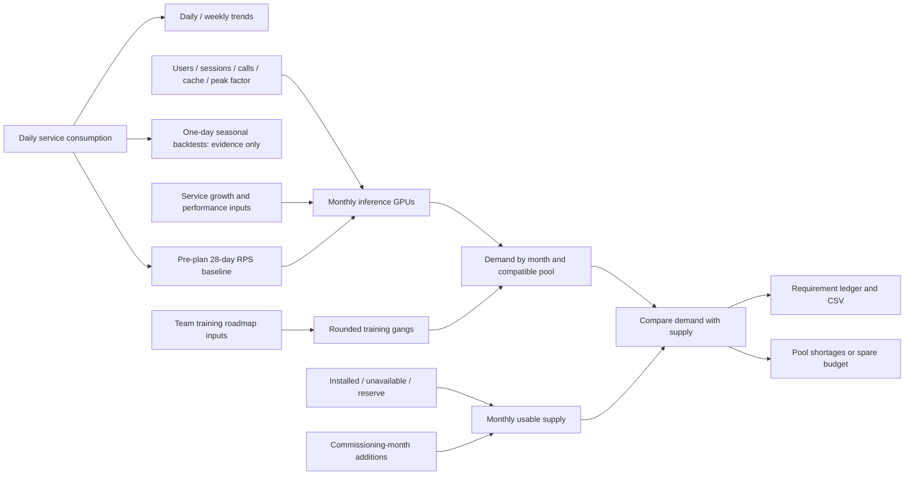
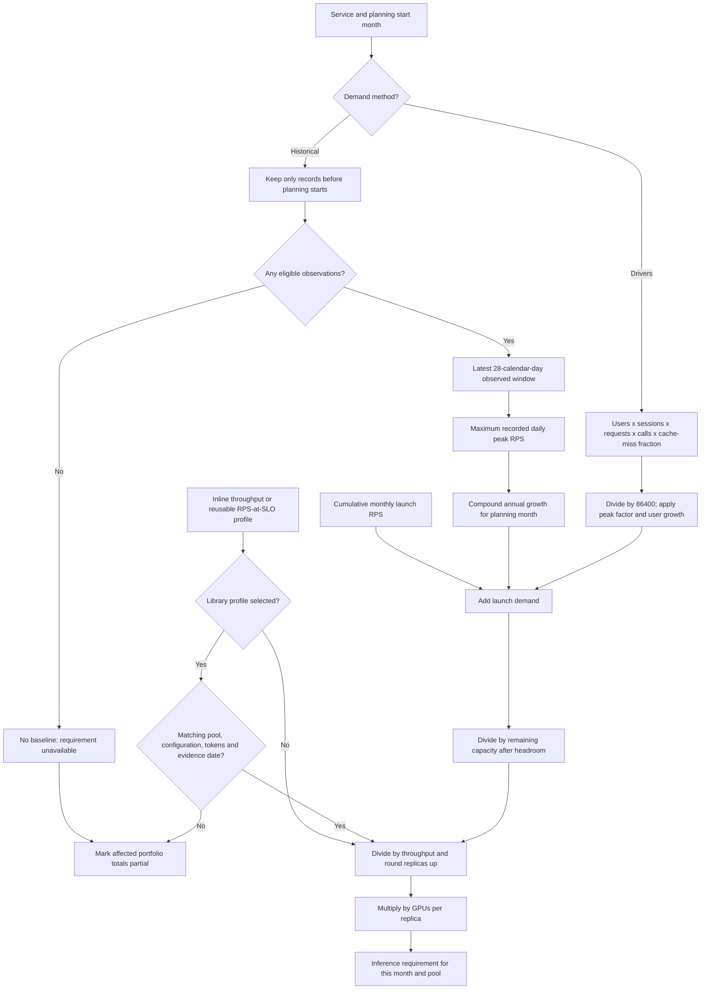
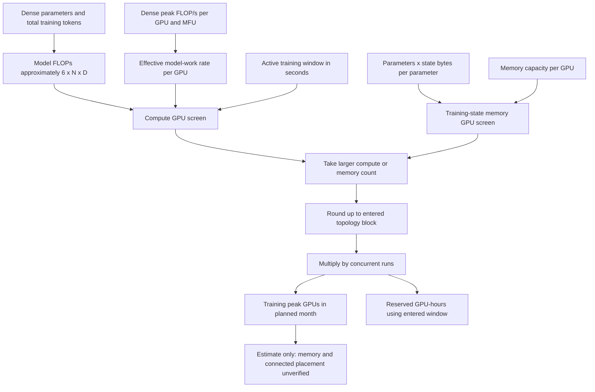
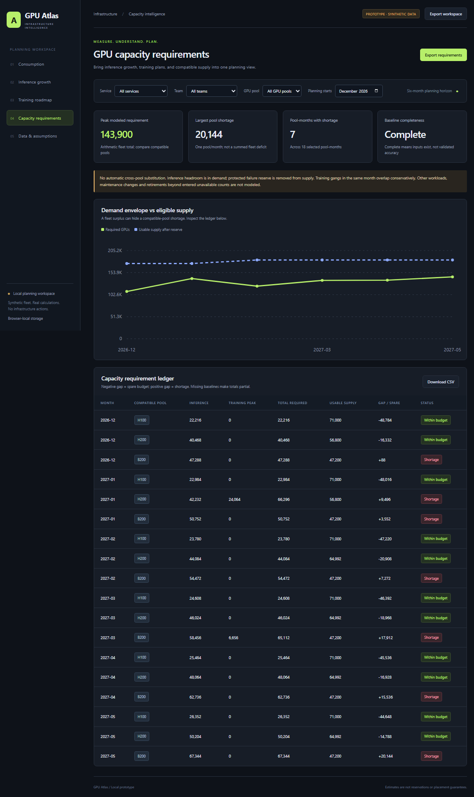

# GPU capacity planning portal

An interactive, browser-local workspace for service consumption, inference
growth, training roadmaps and six-month GPU requirements. All screenshots below
use the synthetic demo; no company-internal telemetry is included.

Inference planning supports **historical traffic or business demand drivers**,
reusable **RPS-at-SLO performance profiles**, and **chronological seasonal
backtests**. Daily forecast evidence is deliberately separate from six-month
scenario planning; it is not evidence that a six-month forecast is accurate.

[Framework](#product-framework) |
[Logic diagrams](#logic-diagrams) |
[UI walkthrough](#ui-walkthrough) |
[Run the portal](#interactive-prototype) |
[Calculation details](#implemented-portal-calculation-logic)


## Product framework

The portal connects **service consumption history -> inference growth +
six-month training roadmap -> time-phased GPU requirements**. It is an
interactive planning workspace, not only a utilization dashboard or an approval
queue. The trace experiment below remains a separate method-validation sandbox.

### Consumption baseline

Attribute resources to team, service, model, workload type, site and hardware
pool with effective-dated ownership. Track allocation/GPU-hours separately from
activity, memory, reservations, quota, queued demand and productive output.
Inference metrics include requests, concurrency, input/output lengths and latency
SLOs; training metrics include tokens/samples, runtime and achieved throughput.
GPU activity is not a measurement of percentage of peak FLOP/s.

Support near-real-time operational windows where connected telemetry permits,
plus daily/weekly summaries. Historical growth uses comparable periods, coverage
checks and annotations for migrations, model changes and efficiency improvements.
YoY needs a year of comparable history; two-year cumulative growth and annualized
growth are distinct. Missing/zero baselines are unavailable, not zero growth.

### Inference growth and requirements

Forecast demand, not only GPU count. Separate traffic growth, workload-mix changes,
named launches and serving efficiency. Convert peak traffic through a measured
performance profile for the model, GPU configuration, serving stack and latency
SLO:

`replicas = ceil(planning peak RPS / sustainable RPS per replica at SLO)`

`GPUs = replicas * GPUs per replica`

Apply explicit headroom/resilience policies without double counting. Validate
memory/KV-cache, prefill/decode mix, routing, batching and compatibility. Historical
GPU consumption alone cannot expose unmet demand.

### Six-month training roadmap

Teams enter architecture/method, parameter count, training tokens or samples,
sequence length, precision, optimizer/parallelism assumptions, experiment count,
hardware and start/completion window. Parameter count alone is insufficient.

For supported dense-transformer pretraining, `model FLOPs ~= 6 * parameters *
training tokens` is a rough approximation, not a universal model. Translate
compute using precision-matched dense peak throughput and benchmark-supported
model FLOPs utilization (MFU), not GPU busy time. Check memory, topology, scaling,
checkpoint/retry overhead and placement separately. Fine-tuning, MoE, long-context
and other architectures require appropriate estimators.

Return gang size, runtime, GPU-hours, compatible configuration, assumptions,
uncertainty and unresolved constraints. Estimates are not allocation guarantees.

### Portfolio capacity plan

Combine inference baseline/growth/launches and scheduled training gangs with
other workloads and explicit reserves, by compatible pool and time window.
Compare with eligible supply, commissioning, maintenance and retirement.
GPU-hours are total work; they cannot substitute for concurrent gang capacity.
Never silently substitute hardware or sum independent service P90s as fleet P90.

The portal should expose consumption, service details, inference planning,
training roadmap, portfolio requirements and assumption/calibration evidence.
Every number must identify observed versus inferred versus synthetic inputs.

## Logic diagrams

These diagrams describe the **implemented local prototype**. Live ingestion,
calibrated forecasting, topology validation and scheduler enforcement remain
future layers. GitHub renders the Mermaid diagrams directly.

### End-to-end planning flow



Consumption trends explain the existing footprint. Inference and training use
different sizing methods, then converge on the same month/pool ledger. A fleet
total never authorizes substitution between incompatible pools.

### Inference sizing and missing-data behavior



Use one organic demand method, not both; launch increments are added once.
Growth and throughput are explicit user assumptions, not inferred from GPU busy
time. Baseline coverage and age must be reviewed in historical mode. See
[inference formulas and example](#5-inference-demand-to-gpu-requirement).

### Training sizing: compute and memory screens



This is a dense-pretraining resource envelope, not a universal model estimator.
The memory screen excludes activations/buffers, and topology rounding is not a
placement check. See [training formulas and example](#6-training-model-to-compute-and-memory-envelope).

## UI walkthrough

Screenshots are captured from the actual portal at a reduced browser scale so
the wide planning tables are visible, with full-page captures except for the
cropped input dialog. They are documentation snapshots, not live views.
These captures show the original portal release; the current navigation also
includes **Performance profiles** and **Forecast evidence**.
The starting inventory is a synthetic 200,000-GPU scenario; the
displayed consumption belongs to the modeled services, not every possible
workload in that inventory.

### Consumption and ownership

The opening screenshot shows the service/team/pool filters, daily/weekly
consumption trend, allocation-weighted activity, coverage and service ledger.
YoY stays unavailable because the seeded history does not contain a full year.

### Inference growth planner

Inspect the baseline, growth assumption, serving profile and projected GPU
requirements. **Configure** opens editable service inputs.


### Training roadmap

Compare model plans, per-run gangs, concurrent GPU counts, reserved GPU-hours and
MFU sensitivity. These results remain subject to the stated memory and placement
limitations.


<details>
<summary>Show the editable training input form</summary>

The form accepts model parameters, total training tokens, active days, hardware
throughput, MFU, memory assumptions and concurrency. Saving validates inputs and
recalculates requirements; it does not allocate infrastructure.


</details>

### Consolidated GPU capacity requirements

Compare inference and training against usable supply by month and compatible
pool. The ledger exposes shortages even where arithmetic fleet totals show
enough resources. **Download CSV** exports the current filtered requirements.



<details>
<summary>Show supply inputs, data provenance and workspace portability</summary>

Edit installed/unavailable/reserve counts, enter commissioning additions, inspect
assumptions, and import/export a browser-local workspace.


</details>

## Interactive prototype

The local portal is [portal/index.html](portal/index.html). Open it directly:

```powershell
Start-Process .\portal\index.html
node --test .\tests\portal-model.test.cjs
```

No package installation or server is required. Service/team/GPU-pool filters, daily/weekly
trends, editable daily consumption, inference profiles/growth, training plans and
supply inputs are interactive. Valid inputs save to this browser's local storage;
export/import JSON moves a workspace between browsers. No company data is sent
to a backend. Do not enter sensitive information in a shared browser.

The seeded hyperscale service history is **synthetic**, independent of Philly.
There is no live telemetry connector, authentication, multi-user sharing or
scheduler enforcement. Near-real-time and multi-year trends are framework
capabilities, not fabricated claims of this prototype.

The first training calculator supports only dense-transformer pretraining,
using explicit MFU and total training-state bytes/parameter assumptions. Memory
is a lower-bound screen, not proof of fit. It schedules all entered runs
concurrently in the selected month; peak GPU requirements are deliberately
conservative and not a placement optimizer. Inference uses user-supplied
RPS-at-SLO profiles; seeded throughput values are illustrative, not benchmarks.
The performance library lets several services reuse compatible evidence.
Demand-driver scenarios can size a service without consumption history.
The Forecast evidence view compares three one-day predictors on chronological
validation and held-out periods, with downloadable evidence JSON.
Month-level supply gaps are deterministic scenarios, not calibrated forecasts.
Consumption baselines use each service's latest 28-day observed window strictly
before the planning start month; sparse or stale baselines remain visible in the
profile table. Seeded history ends November 9, 2026, and the initial planning
window is December 2026 through May 2027. Imported history may extend this.
Changing a historical service's hardware pool through the editor is blocked
because it would relabel past consumption; register a separate migration profile.

## Implemented portal calculation logic

The source of truth for these calculations is [portal/model.js](portal/model.js).
The UI and persistence workflows are in [portal/app.js](portal/app.js), and
formula/invariant tests are in
[tests/portal-model.test.cjs](tests/portal-model.test.cjs).
This section describes what the prototype actually computes, not all the
capabilities envisioned in the product framework.

### 1. Input records and units

- **Service profile:** service/team identity, one compatible GPU pool, GPUs per
  serving replica, sustainable requests/second per replica at the latency SLO,
  assumed annual demand growth, incremental monthly launch RPS, spare headroom,
  and a description of the performance evidence/assumptions.
- **Demand-driver scenario:** daily active users, sessions per user, requests per
  session, backend/model calls per request, cache avoidance and peak-to-average
  factor. Annual growth applies to users in this mode.
- **Performance library:** reusable profile ID, GPU pool, configuration key,
  input/output token bounds, GPUs per replica, sustainable RPS at the SLO,
  measurement date, evidence description and provenance.
- **Daily consumption:** one row per service/date with allocated GPU-hours,
  reported average GPU activity (%), peak RPS, total requests and provenance
  (`synthetic` or `user-entered`).
- **Training plan:** owning service, compatible pool, planned month, dense
  parameter count and total training tokens (both entered in billions), active
  days, dense peak TFLOP/s per GPU, MFU (%), memory per GPU, training-state
  bytes/parameter, topology rounding block and concurrent runs.
- **Supply:** installed, unavailable and protected-reserve GPU counts by pool,
  plus additions and the month each becomes usable.

GPU counts are physical counts within a declared pool. FLOPs measure work;
FLOP/s measures work per second. A TFLOP/s is `10^12 FLOP/s`, and entered memory
GB uses decimal `10^9 bytes`. GPU activity is not MFU or measured FLOP/s.

### 2. Consumption totals and daily/weekly trends

For the selected services, teams, pools and date range:

```text
allocated GPU-hours = sum(daily allocated GPU-hours)

average allocated GPUs =
    allocated GPU-hours / (24 * distinct observed dates)

allocation-weighted activity (%) =
    sum(daily activity (%) * daily allocated GPU-hours)
    / sum(daily allocated GPU-hours)
```

Activity is unavailable when total allocated GPU-hours are zero. The weighted
activity is a summary of supplied daily measurements, not independently measured
productive compute.

Weekly buckets start on Monday in UTC. GPU-hours and requests sum within the
bucket; average allocated GPUs divides by the number of **observed** dates, not
automatically by seven. Edge weeks may be partial. Missing dates are not filled
with zero, and missing service rows can understate organization totals; inspect
per-service coverage rather than interpreting the average as a complete fleet
measurement.

The service ledger's "Period change" compares its last and first observed daily
GPU-hours in the selected window. It is not a fitted trend or an aggregate
week-over-week comparison.

### 3. Historical growth comparisons

```text
growth (%) = (current / previous - 1) * 100

YoY (%) =
    (selected-period GPU-hours / matching-period GPU-hours one year ago - 1)
    * 100

two-year cumulative growth (%) =
    (current / matching-period value two years ago - 1) * 100

two-year annualized growth (%) =
    ((current / matching-period value two years ago)^(1/2) - 1) * 100
```

YoY and two-year comparisons require one daily row for every date in both
periods for every service represented in the current selection. The same service
IDs are compared; extra historical services are not added to the denominator.
February 29 shifts to February 28 when the earlier year is not a leap year.
Missing coverage or a zero comparison baseline returns "Not available", not
zero growth. Unrecorded model/runtime changes can still make a numerically
complete comparison misleading; automatic change-point adjustment is not
implemented.

**Historical growth is not automatically used as the inference growth input.**
The six-month inference planner uses an explicit user-entered annual assumption.
The separate daily backtest compares simple traffic predictors; it does not
fit this annual growth rate or provide calibrated forecast intervals.

### 4. Baseline selection for inference

For each service using **historical demand**:

1. Discard records on or after the first day of the planning start month, so
   later observations do not leak into an earlier scenario.
2. Find its latest remaining observation date.
3. Select the inclusive 28-calendar-day window ending on that date.
4. Take the maximum recorded daily peak RPS as the baseline demand.
5. Report observed-day coverage, last observation date and mean allocated GPUs.

Sparse windows are not expanded or imputed. An old latest observation remains
an old baseline; the prototype does not extrapolate the gap between that date
and the planning start. Review its age/coverage before relying on the result.
If there are no eligible records, the service has **no baseline** and its
inference requirement is unavailable.
Driver-based scenarios do not require this historical baseline.

### 5. Inference demand to GPU requirement

Let:

- `B` = baseline peak RPS.
- `g` = annual demand growth as a fraction (`60% -> 0.60`).
- `L` = additional peak RPS introduced each month.
- `m` = planning month index, from 1 through 6.
- `h` = spare serving headroom fraction.
- `q` = sustainable RPS per replica at the required SLO.
- `k` = GPUs per replica.

```text
historical organic RPS(m) = B * (1 + g)^(m / 12)

driver organic RPS(m) =
    daily active users * (1 + g)^(m / 12)
    * sessions per user * requests per session * model calls per request
    * (1 - cache avoidance fraction) / 86400 * peak-to-average factor

peak RPS(m) = selected organic RPS(m) + L * m

replicas(m) = ceil(peak RPS(m) / ((1 - h) * q))

inference GPUs(m) = replicas(m) * k
```

The first displayed month uses one month of growth; the sixth uses six months.
Launch increments accumulate linearly and are not themselves compounded. Do not
include the same launch in both `g` and `L`. Spare headroom means a fraction of
serving capacity is intentionally unused: 20% headroom divides by `0.8`, rather
than multiplying demand by `1.2`.

The two organic methods are mutually exclusive. In driver mode, growth means
active-user growth; session intensity, agent/model-call multiplier, cache
avoidance and peak factor remain constant across the horizon. Cache avoidance
means the fraction of model calls avoided entirely, not a KV/prefix-cache hit
that still consumes model compute. Launch RPS is additional **post-cache
backend** peak traffic: avoid counting it again in user growth. Multiplying
daily average traffic by a user-entered peak factor is an assumption, not a
modeled arrival distribution.

**Illustrative example:** baseline `100,000 RPS`, annual growth `44%`, additional
`1,000 RPS/month`, 20% spare headroom, `40 RPS/replica`, and eight GPUs/replica:

```text
month-six peak = 100,000 * sqrt(1.44) + 1,000 * 6 = 126,000 RPS
replicas = ceil(126,000 / (0.8 * 40)) = 3,938
GPUs = 3,938 * 8 = 31,504
```

This is scenario arithmetic, not benchmark evidence. Throughput must match
model/version, precision, context/output mix, batching, concurrency and latency
SLO. The calculator does not validate KV-cache fit, queueing, routing or failover.

#### Reusable performance profiles

Choose inline service throughput or a library profile. A linked profile supplies
both `q` and `k`; editing it recalculates every linked service. Existing workspaces
retain their inline values, and seeded library profiles are **synthetic**, not
published NVIDIA benchmarks.

The profile must match the service's GPU pool and exact configuration key, and
the scenario's input/output token counts must lie inside its inclusive bounds.
Its measurement date must be strictly before planning starts. Otherwise sizing
is unavailable and the portfolio is partial: there is **no inline fallback**.
The configuration key should identify model/version, precision, runtime,
batching, concurrency and latency SLO. Profiles should declare sustainable
throughput conservative across their entire stated token range; the portal does
not interpolate token lengths, verify the benchmark or prove the validity range.
Evidence marked `user-benchmark` is a user's attestation, not external verification.

#### One-day seasonal forecast evidence

For each selected service, keep only daily peak-RPS records strictly before
planning starts. Evaluate three predictors:

- **Last day:** preceding day's peak RPS.
- **Weekly seasonal:** mean of the same weekday at offsets 7, 14, 21 and 28 days.
- **Rolling average:** mean of the preceding 28 daily peaks.

All predictors use the same eligible dates and require every preceding 28
calendar days. Missing dates are not zeros and are not imputed. Require at least
14 eligible evaluation days: use the earlier approximately two thirds for
validation, while retaining at least seven validation and seven held-out days.
Select the lowest-validation-MAE model, then report its later held-out evidence.
Ties prefer the simpler predictor in the order listed above.

```text
MAE (RPS) = mean(abs(prediction - actual))
WAPE (%) = sum(abs(prediction - actual)) / sum(actual) * 100
bias (RPS) = mean(prediction - actual)
```

WAPE is unavailable when all actual peaks are zero. Positive bias means
overprediction. JSON stores WAPE as a fraction; the UI converts it to a percentage.
The UI shows validation/held-out scores for all methods, the
selected method's held-out daily predictions, and a one-day prediction after the
latest observation when trailing coverage permits. Each held-out prediction may
use earlier held-out **observed** days, as a rolling one-day-ahead production
forecast would; it is not a recursive multi-day forecast. Selection never uses
held-out errors.

Export JSON includes fold dates, all scores and selected-method predictions.
Sparse data returns an explicit unavailable reason. This evaluates daily
peak-RPS prediction only, not tail risk, SLO performance or six-month growth.
No automatic promotion into the scenario planner, uncertainty interval, holiday
model or drift detector is implemented.

### 6. Training model to compute and memory envelope

The current calculator supports dense-transformer pretraining only. Let:

- `N` = parameters in billions multiplied by `10^9`.
- `D` = total training tokens in billions multiplied by `10^9`, including epochs.
- `T` = active training days multiplied by `86,400`.
- `P` = precision-matched dense peak TFLOP/s/GPU multiplied by `10^12`.
- `u` = empirically supported MFU as a fraction.
- `b` = training-state bytes per parameter.
- `V` = GPU memory in decimal GB multiplied by `10^9`.
- `z` = topology rounding block in GPUs.
- `r` = concurrent identical runs.

```text
estimated model work F = 6 * N * D
effective model-work rate per GPU = P * u

compute-only GPUs = ceil(F / (T * P * u))
training-state memory screen GPUs = ceil(N * b / V)

gang GPUs = ceil(max(compute-only GPUs, memory screen GPUs) / z) * z
total concurrent GPUs = gang GPUs * r

idealized active runtime days = F / (gang GPUs * P * u * 86,400)
reserved envelope GPU-hours = total concurrent GPUs * active days * 24
```

The memory screen covers the entered weights/gradients/optimizer-state budget;
it excludes activations, communication buffers and fragmentation and assumes
that state can be suitably sharded. It is a lower-bound screen, not proof of fit.
Topology rounding does not prove that a suitable connected block exists.
MFU is held constant across candidate gang sizes in this prototype, so runtime
is an idealized estimate, not a validated scaling curve.

**Illustrative example:** 70B parameters, 1,000B tokens, 30 days, 1,000 dense
TFLOP/s/GPU, 40% MFU, 80 GB/GPU, 16 state bytes/parameter, an eight-GPU rounding
block and two concurrent runs:

```text
F = 4.2 * 10^23 model FLOPs
compute-only GPUs = 406
memory screen GPUs = 14
rounded gang = 408 GPUs
two concurrent runs = 816 GPUs
reserved envelope = 816 * 30 * 24 = 587,520 GPU-hours
```

The UI also recalculates at MFU multiplied by `0.8` and `1.2`, bounded to 1-100%.
That range is **efficiency sensitivity**, not a statistical confidence interval.
The calculator does not support MoE, adapter fine-tuning, explicit long-context
attention/recomputation costs, checkpoint overhead, failures or scaling curves.
Do not silently treat these model types as dense pretraining.

### 7. Monthly portfolio requirements and shortage logic

For each of the six planning months and each compatible pool:

```text
inference requirement = sum(available service inference GPU estimates)
training requirement = sum(total concurrent GPUs for plans in this month/pool)
total required = inference requirement + training requirement

usable supply = installed - unavailable - protected reserve
                + sum(additions commissioned by this month)

gap = total required - usable supply
```

- A positive gap means shortage; zero or a negative gap means within the entered
  budget. A negative value represents spare budget, not a negative requirement.
- Missing historical baselines or incompatible selected performance evidence make
  the result **partial**, even though known requirements are still displayed.
  Driver scenarios need no history. "Complete" means sizing inputs are available,
  not that coverage, model accuracy or placement has been validated.
- All training plans/runs in the same month overlap for the peak envelope.
  Plans outside the horizon remain saved but do not enter that horizon's totals.
- Additions are fully available from the beginning of their commissioning month
  and persist afterward. There is no modeled within-month ramp or readiness risk.
- Inference headroom is included in demand; protected operational reserve is
  deducted from supply separately. Do not use both for the same reserve purpose.
- Service/team filters select demand but leave the organization's supply shared.
  This comparison is not a service entitlement or guaranteed allocation.
- Pools never substitute automatically. Fleet totals are arithmetic summaries,
  not interchangeable capacity; a global surplus can hide a pool shortage.

**Illustrative supply example:** `64,000 installed - 4,000 unavailable -
3,200 protected reserve + 8,192 commissioned = 64,992 usable GPUs`.
If inference needs 50,000 and training needs 20,000 in that pool/month, the
shortage is `70,000 - 64,992 = 5,008 GPUs`.

The requirements CSV exports `month`, `pool`, `inference`, `training`,
`required`, `usable`, `gap`, `complete` and `missing` for the current filters.
It is a deterministic requirement ledger, not an optimized procurement order.

### 8. Input validation, persistence and operational boundaries

Inputs must be finite and within the model's declared bounds. Counts that
represent discrete replicas/runs/resources must be integers. Validation rejects
unknown service references, duplicate service/plan IDs, duplicate daily
service/date records, impossible calendar dates, nonpositive serving throughput,
invalid MFU, and training durations longer than their chosen month.
Requests cannot exceed peak RPS multiplied by the number of seconds in a day.
Unavailable supply cannot exceed installed supply, and reserve cannot exceed
the remaining supply. Consumption records are not checked against supply as
though that static scenario inventory were a historical source of truth.

Workspace schema version 2 includes driver settings and the performance library.
Version-1 JSON and stored workspaces are migrated without changing historical
demand methods or inline throughput. Migration clones the input and adds defaults;
it does not rewrite the saved browser copy until an explicit edit is saved.
Exports use version 2, and unknown future schema versions are rejected.
The browser storage key remains `gpu-atlas-workspace-v1` for continuity; it is not
the payload schema version.

The editor requires explicit confirmation before replacing an existing daily
record. Workspace imports are validated before confirmation/replacement.
Save failures are shown explicitly. An unreadable/corrupt saved workspace is
not overwritten: the portal shows a demo preview and blocks ordinary saves
until an explicit valid import or reset. JSON export/import is the portability
mechanism; there is no backend synchronization, authorization or multi-user
conflict resolution.

Service ownership is current-profile metadata, not an implemented historical
registry. There are no telemetry collectors, live GPU measurements, effective-
dated migrations, shared-GPU attribution, cost engine, allocation enforcement or
topology-aware scheduler in this portal. Those are future implementation layers,
not facts inferred from the synthetic demo.

## Trace experiment

A reproducible, standard-library-only Python experiment using Microsoft's public
Philly trace. It validates forecasting and GPU-budget scheduling mechanics before
building a platform UI. **It is not a hyperscale-validated production planner.**

## Run on Windows

Python 3.12+ and `curl.exe` are required. No packages need to be installed.
Run from this directory:

```powershell
python download_trace.py
python prepare_trace.py
python -m unittest discover -s tests -v
python experiment.py
Start-Process .\results\index.html
```

To reproduce the additional low-capacity sensitivity test with the same trace,
window, deadlines, and random seed:

```powershell
python experiment.py --capacity-fraction 0.10 --output results\constrained
Start-Process .\results\constrained\index.html
```

The sensitivity test may take several minutes because much longer queues require
more scheduling work. Compare it with the primary run; do not present the
constrained budget as observed production capacity.

The downloader verifies the publisher's Git LFS SHA-256 and file size before
promoting a `.part` file. Failed downloads remain resumable and are not treated as
success. A mismatched existing archive fails explicitly.

The archive is 1,055,988,361 bytes. Preparation extracts only the approximately
39 MB job log and the small machine inventory, not the roughly 7 GB of expanded
telemetry. Archive members are streamed; only two exact allowlisted names are
written, without extracting archive paths.

Example experiment configuration:

```powershell
python experiment.py --cutoff 2017-11-15 --hours 48 --draws 30 `
  --capacity-fraction 0.35 --seed 20261107 --output results
```

Use another midnight cutoff only when the trace has 28 complete prior history
days and observed future data covering the requested horizon. The source's
timezone-naive wall-clock timestamps are preserved; DST ambiguity is unresolved.

## Persistent results

- `results/index.html`: self-contained decision report, usable without a server.
- `results/report.json`: audit, assumptions, forecast scores, scenarios, per-team
  impacts, capacity candidates, and all conditional commitment risks.
- `results/forecast_backtest.csv`: chronological one-day predictions and actuals.
- `results/hourly_forecast.csv`: next-day arrival forecast allocated by historical
  hour-of-day shape.
- `results/commitments.csv`: per-job outcomes and risks for every scenario.
- `data/philly/manifest.json`: download provenance and archive member inventory.

## What is observed, inferred, and synthetic?

**Observed:** job submissions, attempt timing/status, recorded GPU allocations,
and static machine GPU counts/memory.

**Inferred/derived:** job GPU requirements from recorded allocations;
active runtime summed across retries; hourly arrival
shape, runtime distributions, and forecast uncertainty bands.

**Synthetic:** equal entitlements for five historical top-work virtual clusters
plus a pooled `other` group; a homogeneous compatibility domain; allocatable
capacity fraction; completion deadlines;
immediately usable additional capacity rounded to eight-GPU units; 10% per-job
conditional miss-risk target.

No real team quotas, project deadlines, GPU models, topology, costs, procurement
dates, or NVIDIA fleet information are supplied by this experiment.

## Forecast logic

All valid submissions contribute to the daily arrival series, even if their GPU
execution cannot be modeled. The first and last partial days are excluded.
Each prediction uses only the preceding 28 days:

1. Previous same weekday (`seasonal_7d`).
2. Mean of the preceding 28 days (`rolling_28d`).
3. Mean of four preceding matching weekdays (`weekday_4w`).

The winning model is selected using only pre-cutoff validation MAE. Subsequent
daily predictions are rolling-origin held-out evaluations. Reported metrics are
MAE, WAPE, and signed bias. Empirical 80% bands use pre-cutoff residual quantiles;
their later coverage is measured rather than assumed.

An arrival count forecast is **not** a required-GPU forecast. Propagating
future-arrival uncertainty into the scheduler is a later experiment, not a hidden
claim of this implementation.

## Scheduling and risk logic

The replay accepts only fully timed, positive-GPU, fixed-size jobs whose attempts
do not overlap. Exclusions are counted and
examples retained. Failed/killed work and active retries are included; this models
execution work, not successful completion of a logical training objective.

The held-out cohort is retrospective. Original requested sizes are not known;
recorded allocation sizes are revealed as surrogate requests at submission.
Pools start empty, so pre-window running and pending jobs are not reconstructed.

The scheduler is event-driven and non-preemptive. It releases jobs at arrival,
checks the declared pool GPU budget and entitlement, and records infeasible gangs.
FIFO means oldest **feasible** request first, with opportunistic backfill, not
strict head-of-line blocking. EDF changes ordering by synthetic deadline.
There is no duration-aware reservation/backfill guarantee.

Four alternatives use the same workload and paired runtime samples:

- Baseline equal-quota FIFO, without entitlement borrowing.
- FIFO with idle-entitlement borrowing within the same physical pool.
- Equal-quota earliest-deadline-first, without borrowing.
- FIFO with 25% more capacity, rounded to eight-GPU units and re-apportioned quotas.

Borrowing is not a physical move or a start-time guarantee. Borrowers cannot be
preempted; a later donor request may be delayed. Inspect per-team miss-rate changes
before describing borrowing as an improvement.

Runtime medians and samples use only jobs completed before cutoff, grouped by
pool and logarithmic GPU-size bucket. Sparse buckets fall back to their pool's
explicit historical evidence. Unknown pools fail rather than invent runtimes.
Deadlines are arrival plus the larger of two hours or twice that historical p75
runtime, never a function of held-out actual runtime.

Monte Carlo varies runtime only, using identical samples across alternatives.
Reported probabilities are **uncalibrated, conditional model outputs**. They do
not include future-arrival uncertainty, correlated failures, supply delays,
running-job residual life, or censoring corrections. Actual-duration replay is a
separate retrospective policy evaluation; its runtime is not exposed to ordering.
Each commitment also reports a runtime-only risk lower bound: the fraction of
sampled executions that would miss even if they started immediately. If this
alone violates the target, additional capacity cannot satisfy the unchanged
deadline under the declared model.

A finite grid tests capacity with borrowing plus EDF. A candidate passes only if
every modeled commitment's sampled miss probability is at most the synthetic 10%
target. If none passes, the report explicitly declines to recommend a GPU count.
This search is neither a cost optimization nor a globally minimal capacity proof.

## Scope limits and hyperscale path

The downloaded inventory contains 552 machines and 2,490 GPUs, not hundreds of
thousands. The audit found some allocation details with more GPUs than their
matching static machine count. GPU labels are opaque identifiers, not bounded
array indexes. This inconsistency is reported, not hidden by dropping otherwise
valid jobs or inventing a corrected inventory.

Because hardware mapping is not reconciled, the replay assumes one synthetic
homogeneous compatibility domain. Static GPU count is only a declared budget
reference, not verified usable capacity. Topology, GPU type, CPU, storage,
network, power, security constraints, health history, and commissioning are absent
from the modeled inputs. No exact-placement feasibility is claimed.

Next validation steps are a true running/pending snapshot, forecast-generated
arrival scenarios, calibrated and correlated risk models, heterogeneous
topology-aware placement, then a separately labeled 200,000-GPU synthetic stress
test or a public fleet-scale trace. Do not interpret copying/scaling Philly jobs
as real hyperscale demand.

## Attribution and license

Source: [Microsoft Research / Project Fiddle Philly traces](https://github.com/msr-fiddle/philly-traces),
licensed [CC BY 4.0](https://creativecommons.org/licenses/by/4.0/).
Source publication: *Analysis of Large-Scale Multi-Tenant GPU Clusters for DNN
Training Workloads*, USENIX ATC 2019.

Archive SHA-256:
`2037ccf63a725a02be718b0e1aeee6142c90b7f62d0d849295120e9f6ba13d2c`.

The experiment transforms and filters the trace, derives summaries, and applies
synthetic planning policies. No endorsement by Microsoft or NVIDIA is implied.
Preserve this attribution and identify transformations when sharing derived data.
