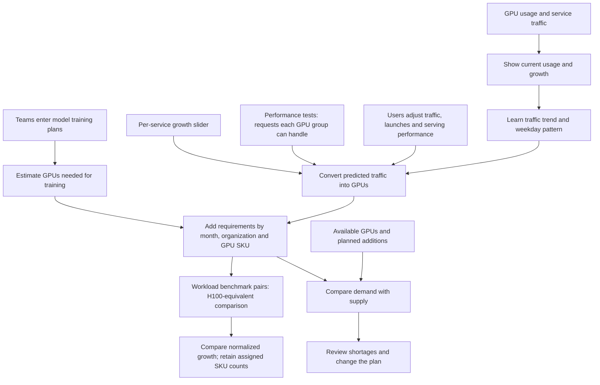
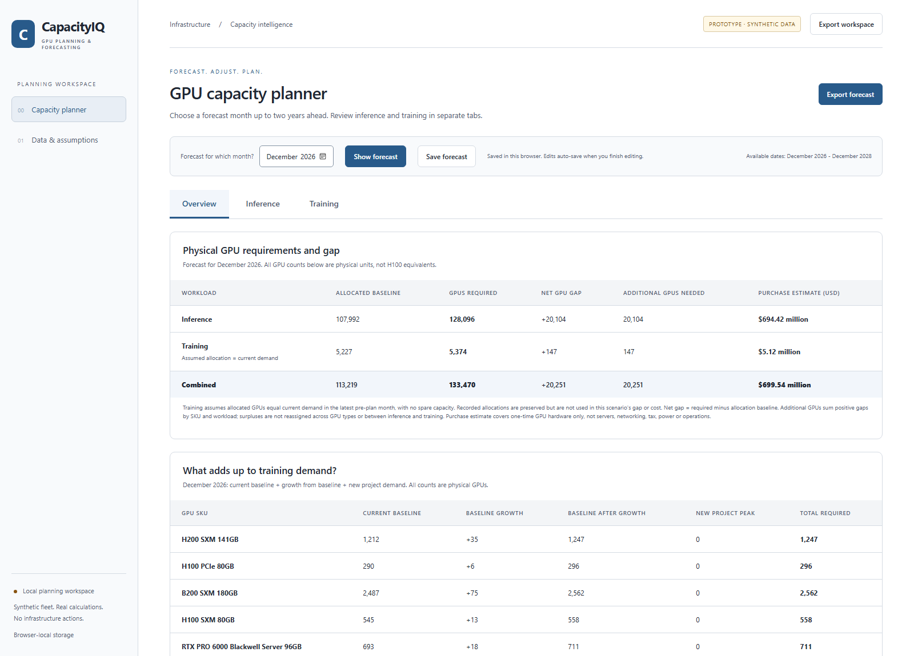
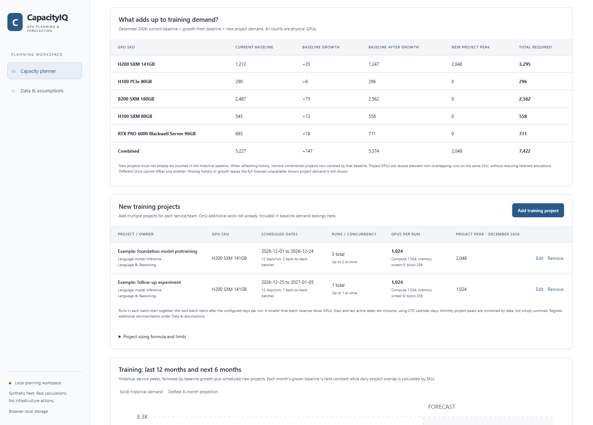
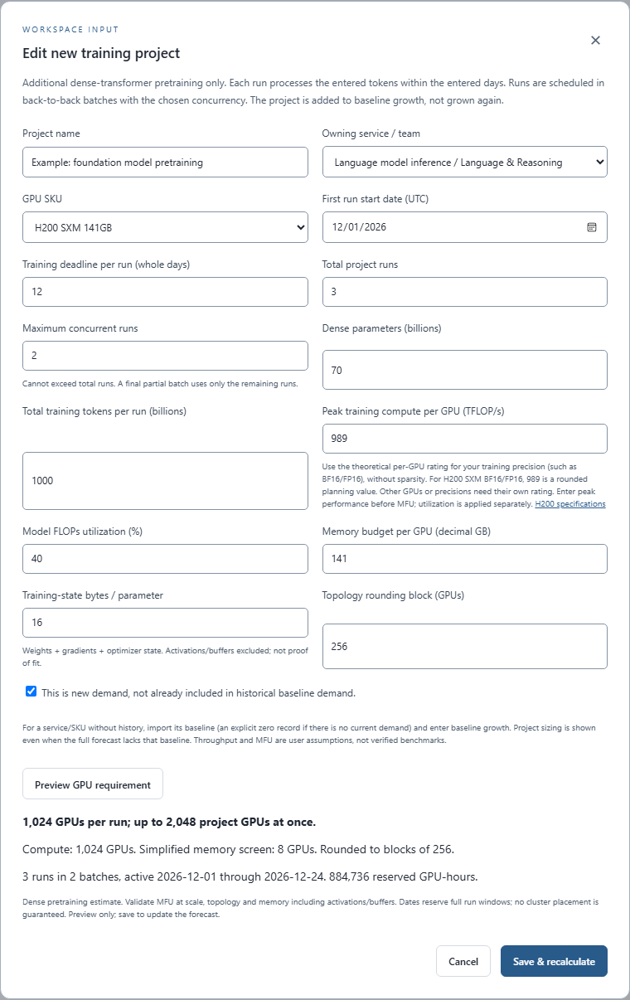

# CapacityIQ: GPU planning and forecasting

Formerly GPU Atlas. The product rename preserves existing browser-local
workspaces and import formats; new workspace exports use `capacityiq-workspace.json`.

**Live website:** https://purple-rock-02dda530f.6.azurestaticapps.net/

Public Azure Static Web Apps deployment on the Free plan. The Dev Box does not
need to stay running for visitors to use it. Each browser/origin has its own saved
workspace; export/import JSON to transfer a local forecast to the hosted site.

## What is the goal?

Help infrastructure teams answer one question:

**How many GPUs will the company need in the selected month, and where will
we run short?**

The platform supports training-heavy capacity planning while keeping inference
separate. It combines historical demand, editable baseline growth, and new
parameter-sized training projects owned by service teams. Users can adjust
serving performance and import inference and training demand history.

It helps them understand:

- Which services and teams use GPUs today.
- How usage and customer traffic are growing.
- How historical training demand is growing.
- How new projects, deadlines and overlapping runs change training requirements.
- Whether current allocations cover those needs.

The default **Capacity planner** has Overview, Inference, and Training tabs.
It projects historical demand at an editable growth pace and compares it with
recorded inference allocations and an explicit training allocation baseline.
**Data & assumptions** is the only other sidebar entry;
it contains service settings, performance evidence, history, and import/export.
Earlier model functions and saved roadmap data are retained, but their separate
navigation pages have been removed.

The portal runs in your browser and includes a sample 200,000-GPU inventory
and service history.

[GPU SKUs](#does-it-account-for-the-gpu-sku) |
[Sample workloads](#which-workloads-are-in-the-example) |
[Data inputs](#where-would-the-data-come-from) |
[Planning logic](#how-the-planning-logic-works) |
[Using the portal](#what-does-the-user-do) |
[Screenshots](#screenshots) |
[Run locally](#run-the-portal) |
[Limitations](#what-it-does-not-do-yet)

## Forecast logic at a glance

**Training requirement = current baseline + growth from baseline + new project peak.**

1. **Establish the baseline.** Use each service/SKU's peak GPU demand in the
   latest month before planning starts. Missing history is unavailable, not
   zero. Changing the target month does not move that baseline.
2. **Project existing demand.** By default, convert observed year-over-year
   growth into a six-month rate: `sqrt(1 + YoY / 100) - 1`. Users can override
   that rate. For forecast month index `i` (first month = 1), multiply current
   demand by `(1 + sixMonthGrowthPct / 100)^(i / 6)` and round up per service/SKU.
   For example, +44% YoY implies +20% per six months.
3. **Size new training projects.** Estimate work as `6 * parameters * tokens`
   for dense-transformer pretraining. Divide by each GPU's effective compute
   over the run deadline. Check training-state memory separately, take the
   larger count, and round up to the configured GPU allocation block.
   [See the formulas and assumptions](#new-training-projects).
4. **Schedule actual overlap.** Batch total runs using the maximum concurrency.
   Start the next batch when the previous run window ends; reduce GPU demand
   for a partial last batch. Add only simultaneously active project GPUs,
   taking the monthly peak jointly for each exact SKU. Project demand is not
   multiplied by baseline growth and must not already be in the baseline.
5. **Calculate gaps and purchase estimates.** Default training allocation equals
   current demand, with no spare capacity assumed; recorded allocations remain
   available as an alternative. `Gap = required - allocated baseline`.
   Purchase units sum positive gaps separately by SKU and workload segment;
   multiply by editable per-SKU USD prices. This is GPU-only hardware cost,
   not a server or data-center budget.
6. **Keep inference and comparisons distinct.** Inference uses projected peak
   RPS, serving throughput, headroom, whole model instances and a historical
   high-demand P90 allowance where available. H100 equivalents are a separate
   approximate FP32 comparison index, not physical GPUs to purchase or measured
   training performance.

### Worked training scenario

The [training screenshots](#screenshots) use the synthetic December 2026 demo:

- Current training baseline: **5,227 GPUs**.
- Growth from that baseline: **147 GPUs**, giving **5,374 GPUs**.
- New H200 project: **70B parameters**, **1T tokens per run**, **12 days/run**,
  **989 TFLOP/s/GPU**, **40% MFU**, **141 GB/GPU**, **16 bytes/parameter**,
  and a **256-GPU block**. Compute requires **1,024 GPUs/run**; the simplified
  memory screen requires **8**, so compute dominates.
- Three runs at concurrency two occupy December 1-24: **2,048 GPUs** for the
  first batch, then **1,024 GPUs** for the final run.
- A second example project uses **1,024 GPUs** from December 25 to January 5.
  It does not overlap the first project, so December's joint project peak is
  **2,048**, not **3,072 GPUs**.
- Total December training requirement: **5,227 + 147 + 2,048 = 7,422 GPUs**.
  Under the no-spare baseline, the training gap is **2,195 GPUs**.

These are illustrative planning inputs, not a validated training benchmark.
The memory screen excludes activations and buffers. MFU at scale, training
precision, parallelism and topology must be validated before procurement.
There is no live cluster integration or reservation action.

## Current capacity planner

The agreed behavior is recorded in [REQUIREMENTS.md](REQUIREMENTS.md).

- **Overview:** a plain-language explanation with examples; current allocated,
  selected-month forecast, and gap in approximate H100 compute equivalents; read-only
  inference/training tables by service, team, and exact GPU SKU.
- **GPU requirements first:** separate Inference and Training cards show the
  selected month's physical GPU totals and a visible exact-SKU breakdown.
  Each workload tab repeats its own card above the chart. These mixed-SKU
  counts are not H100 equivalents or permission to substitute GPU types.
  Missing inputs make the affected total unavailable; known SKU needs remain
  visible. Forecast JSON includes the same `segments` summaries.
- **Physical summary and gap:** the top table shows inference, training and
  combined allocation baselines, GPU requirements, net gaps and additional GPUs needed.
  The combined requirement is the sum of inference and training physical counts.
  H100-equivalent totals are in a separate, initially collapsed comparison.
- **Purchase cost:** enter per-SKU USD prices in Overview or Data & assumptions.
  Fresh workspaces and older workspaces without price settings use the
  [SKU-specific starting estimates](#starting-purchase-price-estimates) below,
  not a uniform GPU price. These are budgeting assumptions, not supplier quotes.
  The complete old all-$30,000 default set upgrades once; other custom settings,
  including zero and deliberately cleared fields, are preserved.
  `gpuPurchasePriceVersion: 1` prevents later edits from being reinterpreted as
  old defaults. Edit each SKU independently. Unspecified legacy variants do
  not receive an automatic price. The one-time estimate covers GPU hardware only,
  excluding servers, networking, tax, power and operations. It is not a quote.
  Additional units sum `max(0, required - allocated)` for each SKU and workload
  segment, honoring saved company allocation corrections when the segment uses
  recorded allocations. The default training scenario instead assumes allocation
  equals current demand. A surplus is not
  automatically reassigned across SKUs or between inference and training.
  Multiply these additional units by their respective prices, not by an
  H100-equivalent gap. A missing price on any positive shortage leaves the total
  unavailable; zero additional demand costs zero without needing a price.
  Missing demand/allocation inputs also leave the estimate unavailable.
  Workspace JSON stores optional `gpuPurchasePrices: [{pool, usdPerGpu}]`.
  Forecast JSON includes `physical`, per-segment/per-SKU cost estimates, and
  `costBasis`; the UI's forecast export also includes `purchasePriceAssumptions`
  with sources, caveats, and the reference-check date. Saved prices round-trip
  through workspace import/export.
  Estimates of at least $1 billion display as, for example, **$2.99 billion**.
  Amounts from $1 million to below $1 billion display as **$267.78 million**;
  smaller amounts remain in dollars.
  Hover for the exact dollar amount; calculations, price inputs, and exports
  retain their original precision.
- **Inference:** a chart of the preceding 12 calendar months of average
  requests/sec and at least six projected months, extended through a later
  selected date. GPU sizing still uses peak traffic,
  service throughput, headroom, and the historical P90 allowance when available.
- **Training:** the same history/projection layout, using recorded peak
  concurrent GPU demand plus new parameter-sized training projects, not inference
  traffic or residual inventory. The Training tab supports multiple projects
  per service/team, with previews and saved create/edit/remove operations.
- **Forecast for which month?** selects a target from the planning start through
  the same calendar month two years later, inclusive. For a December 2026 start,
  December 2028 is selectable. Choosing December shows December's GPU requirement; choosing May
  shows May's. The selection updates automatically and saves as
  `plannerTargetMonth`, independently of the planning start (`startMonth`).
  Summary cards, demand tables, SKU totals and exported results all use that
  target. History and growth assumptions do not move when the target changes.
  Older workspaces default to their planning start, not month six.
- Growth inputs remain six-month percentages. Beyond six months the same pace
  compounds: +20% per six months means +44% after twelve months and +107.36%
  after twenty-four months. Charts and exports extend through the selected
  month. These long-range scenarios are not validated predictions; the P90
  heuristic is not calibrated for a two-year horizon.
- Both demand tables show observed YoY growth and one editable **six-month
  growth** per service/SKU. Following the annual pace means
  `sixMonthGrowth = sqrt(1 + YoY / 100) - 1`. Thus +44% YoY means +20% over six
  months. Overrides replace that default, not stack on top of it. Editing
  auto-saves on blur; **Use historical pace** removes the override.
- The default uses the latest pre-plan month's observations and matching
  prior-year dates. Partial inference months are labeled and compared through
  the same day. Exact YoY needs data beyond the 12 visible chart months.
  Missing observations or a zero prior baseline mean unavailable YoY, not 0%.
  Enter an explicit growth assumption when the default cannot be calculated.
- Inference projects both average and peak traffic with the same growth factor.
  Its P90 allowance applies to peak GPU sizing, not the displayed mean RPS.
  The new planner does not stack the advanced scenario's traffic adjustment,
  throughput adjustment, launch traffic, or legacy scheduled training plans.
  New incremental projects entered in the Training tab are included separately.
- Training demand grows from the latest monthly peak and rounds up to whole
  GPUs. The historical baseline sums service peaks conservatively; they need
  not coincide. Dated new project demand is added using concurrent monthly
  peaks by SKU, not the sum of each project's or service's separate peak.
  The default training allocation baseline equals current pre-plan GPU demand,
  assuming no spare capacity. This is not a measured allocation or the future
  forecast. Inference retains its existing allocation calculation.
- The planner tabs show all services, organizations, and SKUs without a filter
  bar or hidden scope. Data & assumptions retains its filters. The Overview is
  read-only. Save/export include growth inputs, history and new project inputs.
- Applicable company allocation corrections remain in company totals. They are
  not assigned to service rows without ownership data; the UI labels this
  difference. Training corrections are preserved but ignored in the default
  no-spare scenario; selecting recorded allocations restores their use.
  Scoped inference views retain their own recorded allocations.

### New training projects

In **Capacity planner > Training > New training projects**, add multiple named
projects for an owning service/team. Preview the GPU requirement before saving,
then edit or remove a project using its row actions. Register additional
services/teams through Data & assumptions.

The selected-month breakdown is:

`current baseline + baseline growth + new project peak = training GPU requirement`

Each project records parameters in billions, training tokens **per run** in
billions, a UTC start date, a deadline in whole days per run, total runs, maximum
concurrent runs, an exact GPU SKU, precision-matched dense peak TFLOP/s/GPU,
MFU, memory budget, training-state bytes/parameter and a topology block.
The editor requires confirmation that this is **new demand not already included
in the historical baseline**. Projects are not multiplied by baseline growth.
When refreshing historical data, remove incremental projects now included in
that baseline; project membership in historical measurements cannot be inferred
automatically.

Sizing reuses the existing dense-transformer formula:

```
work = 6 * parameters * tokens
compute GPUs = ceil(work / (days * 86400 * peak FLOPs/sec/GPU * MFU fraction))
memory GPUs = ceil(parameters * training-state bytes/parameter / memory bytes/GPU)
GPUs per run = ceil(max(compute GPUs, memory GPUs) / block) * block
```

Memory is only a lower-bound screen: activations, buffers, sharding and topology
feasibility need validation. MFU must be calibrated at the intended scale. Peak
training throughput is entered explicitly; the FP32 normalization index is not
used for training sizing. SKU changes refill memory and clear peak throughput.
The field is labeled **Peak training compute per GPU (TFLOP/s)**. Enter the
theoretical non-sparse rating at the training precision, before MFU. For H200
SXM BF16/FP16, **989 TFLOP/s** is a rounded planning value; NVIDIA's
[H200 specifications](https://www.nvidia.com/en-us/data-center/h200/) list
1,979 TFLOP/s with sparsity, approximately twice the dense rate. Do not use
989 for every GPU or precision, or enter an already MFU-adjusted throughput.
The guidance does not prefill or change the saved throughput input.

Runs start in back-to-back batches of at most `concurrentRuns`. Each batch
reserves its GPUs for the full configured run window; a smaller final batch
uses only the remaining runs. For example, 5 runs at concurrency 2 with 4 days
per run occupy 12 days, with GPU demand proportional to 2, 2 and 1 active runs.
Dates use UTC calendar days with start inclusive and end exclusive; the UI
shows the inclusive last active date. Projects can cross month and year
boundaries, and unscheduled months add no project demand.

For each month and SKU, the model holds the grown baseline constant and takes
the peak of all overlapping project schedules in that scope. Two same-SKU
projects on non-overlapping dates reuse GPU capacity rather than adding their
individual peaks. Different SKUs still sum, because they cannot substitute for
one another. Service-row peaks can therefore differ from the sum used in the
company SKU total. This is a capacity scenario, not a cluster scheduler or
placement guarantee; inter-project dependencies, queue delays, retries, setup
time and resource contention are not simulated.

Missing baseline history/growth is not replaced with zero merely because a
project exists. The project requirement remains visible, but the full forecast
stays unavailable until the service/SKU baseline is supplied. Import an explicit
zero-demand record and enter growth if no current demand exists. Recorded
allocations, inference and legacy roadmap plans are preserved.

Workspace JSON stores `trainingProjects`; older workspaces upgrade to an empty
list and are not automatically populated from legacy `training` plans. Forecast
exports include sized `trainingProjects` with schedules and GPU-hours,
`trainingProjection` with monthly baseline/growth/project breakdowns, and
`trainingProjectPolicy` describing aggregation. Validation supports at most
1,000 projects, 1,000 runs/project, and 1–365 whole days/run, and rejects duplicate
IDs, unknown owners, invalid dates/SKUs, unconfirmed incremental demand and
unsafe numeric results. The project tests include an independent daily
batch-count oracle for monthly overlap peaks.

### Training allocation assumption

The default `trainingAllocationBasis: "current-demand"` sets each service/SKU's
training allocation baseline to its latest pre-plan monthly `peakGpus`. For
example, current demand of 182 GPUs and a forecast of 185 produces a gap of
**+3 GPUs**, even if recorded history retains 216 allocated GPUs.

This assumes no spare capacity; it does not overwrite historical `allocatedGpus`
or company-level corrections. Inference is unchanged. The baseline stays fixed
when growth or the target month changes, and missing current demand remains
unavailable. Zero or declining growth can still produce zero or negative gaps.

Use **Training history data > Training allocation baseline** (also in
**Data & assumptions**) to switch to `"recorded"` and use retained historical
allocations with applicable company corrections. Older workspaces without this
setting adopt the no-spare assumption. Exports include `trainingAllocationBasis`;
training rows retain `recordedAllocated` alongside their selected `allocated`
baseline and `allocationSource`. Gaps, costs and H100-equivalent summaries all use
the selected basis, clearly labeled in the UI.

### Starting purchase-price estimates

References checked November 12, 2026. Rounded USD allowances, not live quotes or
verified market averages. Price and availability depend on OEM, quantity, region,
support, and whether hardware is sold as a card, baseboard, or complete system.

| Exact SKU | Starting USD/GPU | Reference and limitation |
|---|---:|---|
| H100 SXM 80GB | $30,000 | [Indicative pricing guide](https://intuitionlabs.ai/articles/nvidia-ai-gpu-pricing-guide); SXM budgeting allowance, not a standalone quote. |
| H100 PCIe 80GB | $32,000 | [Reported historical PCIe listing](https://gpuperhour.com/blog/nvidia-h100-price) of $32,411.99; discontinued, not a current offer. |
| H200 SXM 141GB | $35,000 | [Secondary guide](https://www.mercatus-ai.com/blog/h200-price) reports $32,000-$40,000 for rare standalone SXM purchases; confirmation required. |
| B200 SXM 180GB | $40,000 | Midpoint of an [indicative $30,000-$50,000 range](https://intuitionlabs.ai/articles/nvidia-ai-gpu-pricing-guide); not a verified standalone quote. |
| RTX PRO 6000 Blackwell Server 96GB | $17,200 | Rounded from the [CDW Server Edition card-kit listing](https://www.cdw.com/product/nvidia-rtx-pro-6000-blackwell-server-edition-graphics-card-rtx-pro-60/8426124) at $17,158.99; not the workstation edition. |

SXM systems typically require integrated baseboards and additional hardware.
These allowances do not turn a baseboard/server price into a GPU-only quote.
The source links describe the starting assumptions, not subsequent user edits.

### Data & assumptions

Expandable sections contain service ownership/SKUs, demand baselines, serving
throughput and headroom, reusable performance profiles, daily inference records,
and training-history import/export. Legacy annual-growth and launch fields are
preserved in workspace data but are no longer shown in the service editor;
current six-month growth is edited in the planner tabs.

The page also contains H100 conversion assumptions, the SKU catalog, supporting
inventory/additions, and workspace import/export and demo reset. Inventory is
not the same as recorded allocations and does not change the new planner's
demand-versus-allocation gap. Allocation records can be maintained with daily
GPU-hours, training-history imports, or full workspace imports (including saved
company corrections). Imports/exports currently use JSON, not CSV.

### Approximate H100 compute index

The user chose published hardware specifications rather than workload-specific
benchmark pairs for the overview. A consistent non-Tensor **FP32 TFLOPS** basis
is used for both allocated and forecast counts:

`H100 equivalents = physical GPUs * selected SKU FP32 TFLOPS / 67`

| Exact SKU | FP32 TFLOPS per GPU | Source |
|---|---:|---|
| H100 SXM 80GB | 67 | [NVIDIA H100 datasheet, hosted by Dell](https://i.dell.com/sites/csdocuments/App-Merchandizing_Documents/en/us/h100-gpu.pdf) |
| H100 PCIe 80GB | 51 | [Same H100 datasheet](https://i.dell.com/sites/csdocuments/App-Merchandizing_Documents/en/us/h100-gpu.pdf) |
| H200 SXM 141GB | 67 | [NVIDIA H200 specifications](https://www.nvidia.com/en-us/data-center/h200/) |
| B200 SXM 180GB | 75 | [Lenovo HGX B200 product guide](https://lenovopress.lenovo.com/lp2226-thinksystem-nvidia-b200-180gb-1000w-gpu) |
| RTX PRO 6000 Blackwell Server 96GB | 120 | [NVIDIA RTX PRO specifications](https://www.nvidia.com/en-us/data-center/rtx-pro-6000-blackwell-server-edition/) |

This is **not measured inference/training performance**, a Tensor Core benchmark,
or a hardware substitution rule. It ignores memory, bandwidth, precision, and
interconnects. H200 can outperform H100 on memory-bound workloads despite an
identical FP32 index. Unknown GPU variants have no guessed conversion factor.
The older workload-matched normalization remains separate in the advanced tools.

### Training history import and persistence

New demo workspaces include 24 months of explicitly synthetic training history.
Existing saved workspaces are not silently backfilled. Use **Add synthetic
training history** in the Training tab, or import real records. The button is
disabled when training history already exists.

The tab can download a template, import history, and export it. Import accepts
an array or an object containing a `trainingHistory` array:

```json
{
  "trainingHistory": [
    {
      "serviceId": "assistant",
      "pool": "H200-SXM-141GB",
      "month": "2026-11",
      "peakGpus": 512,
      "allocatedGpus": 640,
      "source": "user-entered"
    }
  ]
}
```

Use existing service IDs and exact catalog SKUs. Counts must be nonnegative
integers; `source` is `user-entered` or `synthetic`. Each month is one peak
concurrent demand observation for that service/SKU. Explicit zeros are allowed;
absent records remain missing. Import validates all records and asks for
confirmation before merging by service/SKU/month. Matching keys are replaced;
unrelated records are retained. The template is synthetic, not real measurement.

`plannerGrowth` stores independent `{kind, serviceId, pool, growthPct}` overrides.
It does not reinterpret existing `scenarioGrowthPct` fields. Both new fields
round-trip through workspace JSON and browser storage. The new planner JSON export
contains history, monthly projections, physical counts, normalized counts,
filters, and the specification sources.

### Verification

```powershell
node --test tests\training-projects.test.cjs tests\planner-tabs.test.cjs tests\bottom-up-model.test.cjs tests\forecast-model.test.cjs tests\portal-model.test.cjs tests\sku-model.test.cjs
```

## Earlier bottom-up planner design (historical reference)

The following interface description documents the earlier scrolling planner,
not the current three-tab page. Its model functions and advanced tools remain
available; section 8 of the requirements and the current planner section above
take precedence. Scheduled-run growth and workload-matched normalization below
must not be confused with the history-growth planner or its FP32 index.

The starting point is each service, not a company-wide GPU growth target:

1. Learn the service's future traffic from its history, or use its entered
   business-demand plan.
2. Convert that work into GPUs using its selected SKU and serving profile.
3. Let the planner add extra growth for that service.
4. Add training runs in the months they are scheduled.
5. Add those requirements by organization and SKU.
6. Compare the SKU requirements with inventory. Also show H100 equivalents
   so changes in hardware mix do not look like changes in equal-performance
   GPU counts.

### Change inputs and see the result

Open **Scenario planner**, the default page:

The interface uses a white background, dark text, and subdued chart colors.

The planner starts with **Which month should the forecast start?** and a
**Start forecast** button, instead of the Service, Organization and GPU SKU
filter bar. Choose a month and start one six-month forecast for all services.
Changing the picker alone does not save or recalculate the forecast; submitting
it saves the planning start, clears prior scope filters, and selects the first
forecast month for inspection. Existing inputs and allocations are retained,
and starting a forecast does not create another plan or workspace. Other pages
keep their existing filters; organization and model drill-down remains available.

A **Save forecast** button beside **Start forecast** explicitly saves the current
forecast inputs, start month, budgets and allocations. The saved forecast reopens
automatically on the next visit and remains editable. Growth edits also auto-save
when the slider is released or the input loses focus; other editors save on
confirmation. The top status distinguishes saved, pending edits and failed saves.
A different month in the picker must be applied with **Start forecast** before
saving. Saving updates the same forecast rather than creating duplicate plans.
Storage is local to this browser and device, not a signed-in account or shared
backend. Export workspace JSON for backup or to move the forecast elsewhere.

**How this capacity forecast is calculated** follows the month picker, then
the scenario controls. The planner separates **Inference** and **Training**, with
three summary cards: **Current allocated GPUs**, **Forecast GPU need**, and
**Gap** (forecast minus current allocated GPUs, not the budget gap). Current
allocations and forecast need include both segments unless training is excluded.
Incomplete allocations show a labeled known subtotal; the summary gap remains
unavailable until both allocations and forecast are complete. This net physical
GPU comparison does not imply transfers or SKU substitutability. The detailed
segment/SKU tables use the same formula: forecasted GPUs minus current GPUs.
Manual budget edits change neither the forecast nor the gap.
Each titled forecast section has an arrow on the right of its heading to collapse
or expand its content independently. Sections start collapsed, and their open/closed state
is retained while editing growth or re-rendering the current page. Heading
toggles also support keyboard interaction.
The extra planning toolbar is removed: summaries and budget edits
use the forecast start month, charts use physical GPUs, and the full six-month
forecast remains visible. Training inclusion and global adjustments are still
available on **Capacity forecast**; saved settings are not reset. Organization
and model drill-down has a contextual **Back to company forecast** link only
when a narrower scope is open. The small explanation example uses 3 inference GPUs and 6 training
GPUs: 9 total. Current allocated GPUs are 2 for inference and 4 for training; budgets default
to the needs of 3 and 6, leaving gaps of 1 and 2.
These are teaching numbers, not benchmark measurements.

The inference section forecasts service traffic and GPU requirements. The
training section has its own forecast, editable run-growth percentages and
schedule. The optional combined history and normalization section is removed
from the planner to keep the focus on current GPUs, forecasts and gaps.
Historical and prior-year comparisons remain on **Capacity forecast**.
The standalone service-trend panel is also omitted. The service table retains
current usage, growth controls, monthly GPU requirements and model drill-down.

Open **Show detailed formulas and forecasting assumptions** for the inference
and training methods. Actual workspace calculations, including large service
numbers, are in a separate nested **Inspect actual workspace numbers** section;
they update with the selected service, month, growth, and filters. Current
traffic alone does not establish sustainable serving capacity. The current
engine still represents one serving configuration per service; this does not
add fleet telemetry ingestion or multi-model service support.

- **Inference uses requests per second (RPS).** Demand is the incoming peak
  request rate. Throughput is the RPS one GPU replica can serve for that model
  and SKU at the required response time. Keep spare capacity, round up to
  whole replicas, then multiply by GPUs per replica. Size each service
  separately before adding GPU counts; do not divide combined service RPS
  by one company-wide throughput number.
- **Dense training uses model work and MFU**, plus a deadline, memory screen,
  topology rounding, and concurrent runs. Training throughput benchmark pairs
  serve the normalization index; they do not replace the MFU-based sizing math.
- **Capacity is not busy percentage.** GPU-hours and activity describe observed
  usage. The forecast estimates capacity to provision and assumes monthly peaks
  and scheduled training can overlap; it does not optimize their sharing.

- Set growth directly in each row of **Inference demand by service**, beside
  that service's current usage. Drag the slider or type a percentage. Results
  preview immediately without losing keyboard focus or interrupting a drag;
  release the slider or leave the number field to save. **Edit model inputs**
  and **Benchmark pair** are available in the same row. The separate service
  selector and growth panel are no longer needed.
- **+50% means 50% extra demand by month six**, on top of the traffic forecast.
  The increase compounds across six months, so month one gets a smaller
  increase. It is not a flat increase in every month or a replacement for the
  learned trend.
- **Training growth** means extra concurrent runs by month six. For a plan
  scheduled in forecast month `i` (1–6), runs are
  `ceil(baseRuns * (1 + growthPct / 100) ** (i / 6))`. Model size, tokens,
  active days, MFU and GPUs per run stay fixed. Only the scheduled month
  contributes; no recurring jobs are invented in empty months. Growth for
  plans outside the horizon is capped at the horizon endpoints and those
  plans remain excluded from horizon totals. Missing growth defaults to zero,
  preserving existing workspaces. Rescheduling recomputes the growth factor.
- Each segment shows **Current allocated GPUs → Forecast need → Budget → Gap** in that order.
  **Budget follows forecast need automatically**, including growth edits.
  **Edit budget** creates a fixed GPU-count override only for the selected
  month, SKU and service/organization scope. Blank fields follow the forecast;
  zero is an explicit manual budget. **Reset budget to forecast** clears
  overrides for the selected month and scope. Manual budgets never change
  forecast need; budgets below need can leave demand unfunded.
- **Current allocated inference GPUs are populated from existing allocation records.** For each
  selected service, take its highest daily allocated GPU-hours before planning
  start, divide by 24 and round up to whole GPUs. Sum those retained allocations
  by SKU and owning organization. This is a conservative no-reclamation policy:
  lower traffic, GPU activity or subsequent daily allocations do not take GPUs
  back from a team. Current allocated GPUs stay fixed throughout the forecast, independently of
  growth, budget edits and training inclusion. It is derived from daily allocation
  records, not an exact live inventory snapshot. Current service ownership and
  SKU apply; effective-dated service migrations are not modeled.
- **Review allocation baseline** is optional: recorded inference allocations
  are prefilled, not blank inputs to re-enter. Saved company counts are explicit
  inventory corrections and take precedence over derived records at company
  scope. Clearing the inference correction restores the recorded baseline.
  Existing percentage splits remain saved company allocation baselines, not
  forecast budgets. Under service/organization filters, current allocated inference GPUs use
  only that scope's recorded allocations, not the entire company count.
- At company scope, **current allocated training GPUs = usable supply at
  planning start - current allocated inference GPUs**, separately for each SKU.
  This is an explicit planning assumption that all remaining usable capacity
  belongs to training, not unassigned inventory or measured training history.
  Saved training allocation counts (including zero) and legacy splits take
  precedence; clearing a correction restores the remaining-capacity calculation.
  Both current segments therefore sum to usable starting supply unless an
  explicit baseline overrides the assumption.
- Training allocations remain constant across the forecast. Additions ready
  by planning start are included; future additions do not automatically change
  current allocations. Training requirements still come from scheduled runs,
  independently of allocated capacity. Past plans do not recur automatically.
  Company training capacity is not duplicated into each team: scoped training
  allocations remain unavailable without ownership attribution. If inference
  allocation is unknown or exceeds supply, the remaining training count is
  unavailable rather than an invented zero or negative allocation.
- Explicit company allocation counts must fit usable supply at planning start.
  If recorded allocations exceed supply in a scenario, a conflict is shown
  rather than silently capping or reclaiming recorded allocations. Future
  additions increase company supply but are not assigned to a team automatically.
- **Segment gap = Forecasted GPUs - Current allocated GPUs.** Positive means capacity to add to that
  segment; negative means capacity retained by that team, not capacity released
  for other teams to borrow. Manual budget edits do not change this gap.
  The top-level gap sums the selected inference and training forecasts and
  subtracts their current allocations. Review per-SKU gaps separately: spare
  capacity on one SKU does not automatically cover another SKU's shortage.
- JSON forecasts and requirements CSVs include current allocated GPUs (the existing
  `inferenceHave` and `trainingHave` fields), allocation source
  (`recorded-allocation`, `entered-allocation`, `remaining-capacity`, or `missing`), supply conflict
  flags, budget, budget source
  (`forecast`, `manual`, or training `excluded`), segment gaps and completeness
  flags. `gap` remains the forecast need minus all usable supply; the separate
  `budgetGap` uses budget targets instead. Workspace JSON preserves optional
  `inferenceAvailable`/`trainingAvailable` supply counts, scoped `segmentBudgets`
  overrides, and training growth. Missing budget overrides always follow need.
  Excluding training sets its active need and budget to zero without deleting
  its stored overrides or available GPUs; re-enabling restores them.
- Drag a training card to another month. A month selector provides the same
  action without dragging. Active run days stay unchanged; a 31-day run cannot
  move into February.
- On **Capacity forecast**, turn **Include training** off to compare inference-only demand. Training
  plans remain editable and are not deleted.
- The planner's organization/SKU summary and budget editor use the forecast
  start month; monthly service requirements and the training forecast show the
  full horizon.
- The bottom-up chart shows recorded GPU assignments as a **solid historical
  trend that connects directly to the dotted total forecast**, in the same
  color. The dotted portion starts at the final historical point and continues
  through the forecast months. Inference and training forecasts are also dotted.
  The forecast boundary marks where the six-month plan begins. History shows
  the highest daily assignment on recorded days in each observed month; it is
  not a measurement of future capacity needs or a separate training-usage
  history. Missing observations stay blank. Historical assignments are recorded
  in physical GPUs; the H100-equivalent view does not guess historical ratios.
- The chart includes **12 calendar months of actuals**, followed by the six-month
  forecast. Directly underneath, **Actual usage vs previous year** shows each
  month's recorded GPUs, the same month last year, and the gap in GPUs and
  percent. Both periods use the same selected services. The latest partial
  month is compared through the same day last year; complete calendar months
  include all their days, including leap days.
- Gaps are calculated only when both periods have daily records for every
  selected service. Missing months remain blank; partial history is labeled.
  A zero previous-year value has an absolute gap but no percentage growth.
  These comparisons stay in physical GPUs even when the forecast chart uses
  H100 equivalents. They are included in the forecast JSON export.
- The updated demo contains daily synthetic history from **December 2024 through
  November 9, 2026**, enough for all 12 prior-year comparisons. Existing saved
  workspaces are not expanded or overwritten automatically. Import more history,
  or use **Data & assumptions > Load sample workload demo** to replace a workspace
  with the updated example after confirmation.
- **Inference demand by service** is visible directly below the bottom-up demand
  chart, without opening organization drill-downs. It lists every service name,
  owning organization, exact SKU,   current observed peak requests/second, current
    allocated GPUs (highest recorded daily allocation before planning starts), historical demand growth, and all six monthly GPU requirements.
  Service names remain visible while scrolling across the monthly columns.
- Select a service name to see its observed daily demand and forecast GPU trend.
  Historical growth compares the latest complete 28-day peak-demand window with
  the preceding 28 days; missing coverage or a zero earlier peak makes it
  unavailable. Forecast GPU growth compares planning month one with month six.
  These are separate measures, not a comparison of average usage with peak
  capacity. Observation dates are shown so older data is not mistaken for live
  demand. The scenario JSON export includes these per-service series.
- Double-click an organization row, or use **Open models**, to see its
  inference services and scheduled training models. Open an inference model
  to see its configuration and assumptions; open a training model to edit its
  parameters, tokens, timing, and hardware.

The existing service-owning team is used as the organization. Global service,
organization and SKU filters apply to the planner. Training is filtered by its
own GPU SKU, even if its owning service uses a different SKU for inference.
Existing saved workspaces keep their inputs.

### Compare unlike GPUs without inventing an exchange rate

There is no universal rule such as **10 H100 = 1 GB200**. The result depends on
the model, precision, memory needs, software and response-time target. GB200
is also a CPU-plus-two-GPU superchip, not a single GPU.

The common unit here is **one H100 SXM 80GB GPU for the same workload**.
Choose **Benchmark pair** beside a service or training model and enter:

- Throughput per selected-SKU GPU.
- Throughput per H100 SXM GPU for the same workload.
- The evidence date, source, and configuration assumptions.

For inference, the selected rate comes from the current serving profile.
Use requests per second per GPU (RPS/GPU), measured within a full replica at the
required response time. For training, use training tokens per second per GPU
under the same model configuration. Dividing a full replica's throughput by
its GPU count does not mean the model fits on one GPU.

```text
Workload ratio = selected-SKU throughput per GPU / H100 throughput per GPU
H100 equivalents = required selected-SKU GPUs * workload ratio
Assigned-SKU GPUs = H100 equivalents / that same workload ratio
```

For example, if a workload runs at twice the throughput per GPU on its selected
SKU, 100 of those GPUs represent 200 H100 equivalents. Another workload on that
same SKU can have a different ratio. The example pairs in the demo are explicitly
illustrative, not measured performance.

The planner sums these workload-specific equivalents. Training contributes in
its scheduled months. Planner charts use physical GPUs; normalized totals
remain in the organization, model and SKU tables and forecast exports.

The final hardware table retains each workload's assigned SKU and replica
rounding. It does not choose a new mix, move jobs, or treat normalized demand as
interchangeable supply. Inventory and shortages remain exact-SKU counts.

Missing benchmark pairs make normalized totals **unavailable**, with a clearly
labeled known subtotal. Changed model settings, changed serving throughput,
and future-dated evidence invalidate a pair instead of silently reusing it.
Physical requirements remain visible. Moving an unchanged training run between
valid months does not invalidate its pair.

Scenario JSON includes workload rows, organization rollups, SKU totals and
normalization evidence. Monthly CSV includes physical requirements, H100
equivalents and missing-calibration counts. Service growth and benchmark pairs
also persist in workspace JSON; older workspaces need no guessed benchmark data.

## Does it account for the GPU SKU?

Yes. The tool tracks the **GPU variant, memory, and form factor**, not just the
family name. The example inventory includes:

| SKU | Memory per GPU | Form factor |
|---|---|---|
| H100 SXM | 80 GB HBM3 | SXM |
| H100 PCIe | 80 GB HBM2e | PCIe |
| H200 SXM | 141 GB HBM3e | SXM |
| B200, DGX B200 configuration | 180 GB HBM3e | SXM |
| RTX PRO 6000 Blackwell Server Edition | 96 GB GDDR7 | PCIe |

Counts are individual GPUs, not servers or racks. Hardware specification links
are available in **Data & assumptions**. The B200 memory entry refers to the
[DGX B200 configuration](https://docs.nvidia.com/dgx/dgxb200-user-guide/introduction-to-dgxb200.html),
which lists eight GPUs and 1,440 GB of total GPU memory.

Each service, serving test, training plan, inventory count, and planned addition
uses a SKU. Filters and exports use those same identifiers.

- A serving profile for H100 SXM cannot size an H100 PCIe service.
- Spare H100 PCIe GPUs do not automatically cover an H100 SXM shortage.
- Training memory cannot exceed the selected SKU's capacity. Changing the SKU
  fills its memory capacity and clears the old peak-throughput input, so the
  user must enter the right speed for the new hardware and precision.
- Older workspaces keep their family-only counts as **variant not specified**.
  The tool does not guess which hardware was installed.

The SKU identifies hardware; it does not determine serving speed by itself.
That still needs a benchmark for the model, software setup, and response-time
target.

## Which workloads are in the example?

The sample uses generic workload categories:

- **Language models:** model development and serving.
- **Autonomous systems:** driving-model training, simulation and cloud evaluation.
- **Robotics:** model development, simulation and policy evaluation.
- **Video generation:** world models and synthetic video generation.
- **Rendering and simulation:** digital twins, rendering and physics.
- **Scientific models:** biomolecular development and inference.
- **Engineering assistants:** chip-design and engineering assistance.

On-device inference is separate from the data-center fleet. These examples do
not represent any company's actual usage. Traffic, GPU counts, and performance
inputs are illustrative planning data.

Original branded demo service/profile names are upgraded to generic labels on
load/import without resetting inputs. Customized names, IDs, history, allocations,
growth and hardware identifiers are preserved. Normal saving/export persists the
generic labels. Hardware specification URLs remain factual source references.

For non-text services, a request means one fixed, benchmarked operation—for
example, a render, a video generation, or a policy evaluation. Request rates
from different kinds of work are not interchangeable. The forecast converts
each service's own request demand into GPUs before adding capacity requirements.

The training examples are dense language-model experiments. The dense training
formula below is not applied to every video, robotics, or simulation workload.

## How would it work?

Collect service history, learn its traffic trend, and predict future demand.
Then layer team plans onto the prediction and compare it with supply.



In the current prototype, users enter or import the inputs themselves.
The connections described next are suggestions for a real deployment.

## Where would the data come from?

A **data pipeline** collects records from another system, checks them, and puts
them into a format the portal can use. A production version could use five:

### 1. GPU usage

Collect GPU activity from NVIDIA DCGM or Prometheus, and GPU assignment records
from Kubernetes or Slurm.

This tells us **which service was assigned GPUs, for how long, and how busy they
were**. Keep assigned capacity separate from actual activity: a team can hold
GPUs without keeping them busy.

### 2. Service traffic

Collect request counts, peak requests per second, response times, and request
sizes from API gateways or model-serving systems.

This tells us **how much work users are asking the service to do**. GPU usage
alone can miss demand that was queued or rejected.

### 3. Performance test results

Import tests showing how many requests a particular model and GPU configuration
can handle while meeting the required response time.

This tells us **how to convert expected traffic into GPUs**. Record the model,
exact GPU SKU, software setup, and input/output sizes alongside each result.

### 4. Hardware inventory

Read infrastructure records for installed GPUs, unavailable hardware, reserved
capacity, and new GPUs expected to become ready.

This tells us **how much capacity we can actually plan against**. A production
version should also track data-center locations, maintenance, and retirements.

### 5. Service ownership

Read the service catalog and team directory to connect jobs and usage records
to the right team.

This tells us **who is responsible for the demand**. Keep ownership history so a
service moving between teams does not change old reports incorrectly.

Before combining these inputs, agree on service IDs, dates, units, and GPU types.
Reject duplicates and flag missing records. Start with daily summaries; add
updates every few minutes when the source systems support them.

**None of these automated connections is built yet.** The current portal accepts
manual inputs and workspace JSON imports. Daily and weekly views are available;
live updates and historical ownership tracking are not.

## What does the user do?

The data tells us what happened. Teams still need to tell us what they intend
to do next.

1. **Open Capacity planner.** Choose the month whose GPU need you want to see.
   The tabs include all services, teams, and GPU SKUs.
2. **Review Overview.** Read the explanation, normalized summary, and physical
   service/team/SKU needs.
3. **Review Inference.** Compare historical throughput with its projection.
   Keep the historical growth pace or enter one six-month growth percentage.
4. **Review Training.** Import training history or use the labeled demo data.
   Adjust training growth separately.
5. **Save or export.** Edits save in the browser. Export workspace JSON for a
   backup; export forecast JSON for the current results.
6. **Maintain Data & assumptions.** Configure services and performance profiles,
   update history/allocation inputs, or import/export the workspace. The planning
   start is available here; changing it resets the selected forecast month.

For example, a planner can change a service's six-month growth assumption and
compare GPU need for different target months. The portal recalculates estimates;
it does not reserve GPUs or make operational changes.

## How the planning logic works

This section documents historical models and UI workflows retained in the code,
not pages available in the current navigation. For the new
history-growth planner, see [Current capacity planner](#current-capacity-planner).

### A. Measure current usage

Each daily service record contains assigned GPU-hours, average GPU activity,
peak requests per second, total requests, and whether the record is sample data
or user-entered.

**GPU-hours measure assigned capacity over time.** Eight GPUs assigned for three
hours equals 24 GPU-hours. That does not mean they were busy for all three hours.
The activity percentage is shown separately.

The portal adds these records into daily or weekly totals. Average assigned GPUs
uses the number of observed days; missing days are not filled with zero.
Activity averages are weighted by assigned GPU-hours.

Year-over-year and two-year comparisons need complete records for the matching
periods. If history is missing or the earlier value is zero, the portal says the
comparison is unavailable. These comparisons help users choose growth assumptions;
they do not automatically set the future growth rate.

### B. Estimate GPUs needed to serve requests

Using a trained model to answer requests is called **inference**.
The portal first estimates traffic, then converts that traffic into GPUs.

**For an existing service, learn from its history:**

1. Take up to 364 consecutive daily records (52 weeks) before planning starts.
   At least 42 are needed; missing days are not filled with zero.
2. Try two methods: a recent average and a straight-line trend fitted to weekly
   averages. Only the linear trend learns which weekdays tend to be busier.
3. Keep the final 14 days aside. Predict those days using only the earlier data
   and choose the method with the smaller average error. These are multi-day
   predictions, not predictions updated with each day's actual result.
4. Fit the selected method again with all the recent history. Predict daily
   peaks through the next six planning months, including any gap between the
   latest observation and the start of the plan.
5. Use the busiest predicted day in each month to size serving capacity.
6. Build a traffic band from the 14-day errors. The band widens with the square
   root of months ahead. Sizing uses the high-demand (P90) case; the median (P50)
   case is shown alongside. The spread is heuristic: 14 held-out days do not
   calibrate six-month uncertainty. Services without a usable band (no history,
   or zero traffic) show P90 = P50.

The method, days of history, last observation, selection error, and band
appear under **What is driving the forecast?** The 14-day error helps choose a
method; it does not measure accuracy six months ahead. Budgets default to the
P90 need.

**Then apply your adjustments:**

- **Traffic +20%:** increase predicted traffic by 20%.
- **Throughput +20%:** each serving group handles 20% more requests, reducing
  the number of groups needed.
- **Include launches:** add the launch traffic entered for each service. Monthly
  increments accumulate once; they are not also multiplied by the traffic adjustment.
- **Include training:** add the training roadmap to the serving requirement.

Adjustments apply across the workspace and are saved with it.
The Scenario planner also applies each service's extra growth:
`(1 + growth / 100) ^ (planning month number / 6)`.
That factor affects organic demand, before launches are added.
The base serving line excludes these changes and training. It still includes
each service's existing spare-capacity allowance.

**For a new service without history:** select a user-based plan in **Service
plans**. Multiply daily users by sessions, requests, and model calls; subtract
calls avoided entirely by cache; convert to requests per second and apply the
peak-traffic factor. In the capacity forecast, a driver plan grows only with its
extra demand by month six; the annual user growth input drives the Service plans
calculator and its manual scenario, not the learned forecast.
This is labeled as an entered plan, not a learned traffic trend.

The **Service plans** page retains the earlier manual annual-growth calculator
for comparison. Its annual traffic growth input does not drive the learned
forecast.

**Then convert peak traffic into GPUs:**

```text
GPU groups needed =
    round up(peak requests per second /
             (requests per second per group * 0.8))

GPUs needed = GPU groups needed * GPUs per group
```

A group is one serving replica (one running instance of the model), which may need several GPUs.
For 20% headroom, each group is planned at 80% of its measured requests per second, so use 0.8.

**Example:** suppose the traffic forecast predicts a peak of 126,000 requests
per second. If an eight-GPU group handles 40 requests per second, with 20% capacity kept
spare, the service needs **3,938 groups, or 31,504 GPUs**.
These are illustrative inputs, not measured hardware performance.

A saved performance profile lets services share a test result. It must match
the exact GPU SKU, configuration key, and request-size limits, and its evidence must
be dated before planning starts. A mismatch makes the estimate unavailable;
the portal does not quietly use a different number. User-supplied test results
are not independently verified.

### C. Estimate GPUs needed for training

Teams enter model parameters, total training tokens, planned month, active days,
GPU speed and memory, expected training efficiency, and simultaneous runs.
Parameters and tokens are entered in billions.

The current calculator supports **dense-transformer pretraining**:

1. Estimate the work as roughly `6 * model parameters * training tokens`.
2. Divide that work by the available time and effective computing speed of one
   GPU to estimate the GPU count needed to finish.
3. Estimate a minimum GPU count for model weights, gradients, and optimizer memory.
4. Take the larger count and round up to the requested GPU group size.
5. Multiply by the number of runs happening at once.

Effective computing speed is the GPU's stated peak speed multiplied by expected
training efficiency. The UI calls that efficiency **MFU**: the share of peak
computing speed used for model work. It is not the GPU busy percentage.

The memory estimate excludes temporary working memory and communication buffers.
It is a minimum check, not proof that the job fits. The calculator also assumes
runs in the same month overlap; it does not find an efficient schedule.

### D. Compare demand with supply

For each month and GPU SKU:

```text
Total needed = serving GPUs + training GPUs

Available = installed - unavailable - reserve + additions ready by that month

Shortage = total needed - available
```

For example, `64,000 - 4,000 - 3,200 + 8,192` gives 64,992 available GPUs.
If demand is 70,000, the shortage is **5,008 GPUs**.

Keep SKUs separate: even two H100 variants have separate demand and inventory.
Likewise, a job needing 4,096 GPUs at once cannot run simply because
enough GPU-hours are available across different days.

New additions count from the start of their entered month. Service and team
filters reduce the displayed demand, but supply remains the shared company
inventory; the result is not a team's guaranteed allocation.

If a service cannot be estimated, the portal marks the total **partial** and
still shows the requirements it can calculate. A complete total means the inputs
exist, not that every assumption or physical placement has been verified.

### E. Check short-term traffic predictions

The **Daily backtests** page asks a smaller question: *could a simple method
have predicted the next day's peak traffic?*

It compares:

- Yesterday's peak.
- The peak on the same weekday last week.
- The average peak over the previous 28 days.

Each prediction uses only earlier observations. All three methods need the same
28 complete prior days and at least 14 days to test predictions on.
The earlier part of that test period chooses the method; the later part checks it
on days that were not used to choose it. Each part has at least seven days.

The page reports average error, percentage error, and whether predictions tend
to be too high or too low. You can export the scores and daily predictions.
These are separate one-day checks. The main capacity forecast uses the multi-day
model comparison described above.

## Screenshots

Captured from the current CapacityIQ interface using synthetic data. Click an
image to inspect it at full size. The screenshots do not contain a user's saved
workspace or create projects automatically for new visitors.

### Capacity overview

Physical inference/training requirements, allocated baselines, gaps and
GPU-only purchase estimates. This is the default demo **before adding projects**.



### Training baseline, growth and new projects

Two illustrative projects belong to the same service/team. Their schedules
do not overlap, so the new project contribution is the larger concurrent peak,
not the sum of their individual peaks. The breakdown shows **7,422 total
training GPUs** for December in the [worked scenario](#worked-training-scenario).



### Project inputs and sizing preview

Model size, tokens, deadline, total runs, concurrency and exact-SKU assumptions
produce a preview before saving. The confirmation prevents treating a project
as incremental without acknowledging that it is not already in the baseline.



<details>
<summary>Earlier prototype screenshots (historical reference)</summary>

The following screenshots show earlier workflows, not the current navigation
or the dated-project scheduling described above.

**Interactive scenario planner:** edit a service's growth and compare physical
and H100-equivalent demand.


**Organization drill-down:** inspect inference and training models together.


**Training scheduling:** drag plans between months or use the month selector.


**Capacity forecast:** historical usage, a learned forecast, and a plan with
25% extra traffic. The controls let users compare changes directly.


The historical screenshots use older demo labels; the current sample has generic
workload names and exact GPU SKUs.

**Consumption:** see which services use GPUs and how usage changes.


**Inference planning:** edit growth and serving assumptions.


**Training:** enter model plans and inspect estimated GPU needs.


<details>
<summary>Show the training input form</summary>


</details>

<details>
<summary>Show inventory and workspace controls</summary>


</details>

</details>

## Azure deployment

Deployed November 12, 2026:

- Static Web App: `capacityiq`
- Resource group: `rg-capacityiq-demo`
- Region: East US 2
- Plan: Free
- Production URL: https://purple-rock-02dda530f.6.azurestaticapps.net/
- Published content: only the four files in [portal](portal).
- No backend, database, paid services, custom domain, or automated Git deployment.

The site is public and does not require sign-in. Browser-local data is not
uploaded or synchronized. The approved CSV backend remains unimplemented.
Local changes require a new deployment; they are not published automatically.

To redeploy, run the following **from the repository root, not from inside
`portal`**. The deployment client requires its working directory to be outside
the artifact folder. The isolated Azure CLI profile preserves other Azure logins.
If its session expires, use `az login --use-device-code` after setting
`AZURE_CONFIG_DIR`, and select the intended subscription before deploying.

```powershell
$env:AZURE_CONFIG_DIR = Join-Path $env:LOCALAPPDATA 'CapacityIQ\AzureCLI'
$env:SWA_CLI_DEPLOYMENT_TOKEN = az staticwebapp secrets list `
  --name capacityiq --resource-group rg-capacityiq-demo `
  --query properties.apiKey --output tsv
if ($LASTEXITCODE -ne 0 -or [string]::IsNullOrWhiteSpace($env:SWA_CLI_DEPLOYMENT_TOKEN)) {
  throw 'Unable to retrieve deployment credential.'
}
try {
  npx.cmd --yes --package=@azure/static-web-apps-cli@2.1.0 swa deploy .\portal `
    --env production --no-use-keychain
  if ($LASTEXITCODE -ne 0) { throw 'Deployment failed.' }
} finally {
  Remove-Item Env:\SWA_CLI_DEPLOYMENT_TOKEN -ErrorAction SilentlyContinue
}
```

Never print, commit, or share deployment tokens. After publishing, check the
public website and its assets before sharing the updated result.

## Run the portal

Open [portal/index.html](portal/index.html) in a browser. On Windows:

```powershell
Start-Process .\portal\index.html
```

No backend server, build step, or package installation is needed to run locally.
Edits save in the browser's local storage. Export workspace JSON to keep a copy
or move it to another browser. Import replaces the workspace after validation
and confirmation. Version-1 and version-2 workspaces upgrade to version 3 while
preserving their inputs. Existing family-level counts remain unspecified
variants; loading the sample workload demo requires explicit confirmation
in **Data & assumptions**. Forecast adjustments are included in workspace exports.
The `pool` field now holds the SKU ID. Monthly CSV also includes the SKU name,
memory, and form factor; forecast JSON includes the SKU catalog.

The sample history ends November 9, 2026. The default plan covers December 2026
through May 2027. You can enter a different planning start month.

Run the JavaScript calculation tests with Node.js:

```powershell
node --test .\tests\training-projects.test.cjs .\tests\planner-tabs.test.cjs .\tests\portal-model.test.cjs .\tests\forecast-model.test.cjs .\tests\sku-model.test.cjs .\tests\bottom-up-model.test.cjs
```

The calculations are in [portal/model.js](portal/model.js), the UI is in
[portal/app.js](portal/app.js), and tests are in
[tests/portal-model.test.cjs](tests/portal-model.test.cjs) and
[tests/forecast-model.test.cjs](tests/forecast-model.test.cjs), with SKU and
migration checks in [tests/sku-model.test.cjs](tests/sku-model.test.cjs).
Growth, normalization, organization rollups and rescheduling tests are in
[tests/bottom-up-model.test.cjs](tests/bottom-up-model.test.cjs).

## What it does not do yet

- **No live company data:** connections to monitoring, inventory, and service
  catalogs still need to be built. The sample inventory is not a fleet-scale
  performance test.
- **No shared company service:** there is no login, backend, or multi-user editing.
  Do not enter sensitive information in a shared browser.
- **No automatic allocation:** the portal does not grant quotas, borrow capacity,
  start jobs, purchase GPUs, or enforce a schedule.
- **No guarantee that a job can run:** it does not check network layout, connected
  GPU placement, complete memory fit, or detailed hardware compatibility.
- **No universal model calculator:** training support does not yet cover
  mixture-of-experts models, fine-tuning, or detailed long-context costs.
- **No annual seasonal model:** the learned forecast uses recent history and
  weekday patterns, not annual holidays or business cycles.
- **No guaranteed forecast:** past trends and plans can change. Failures,
  changing efficiency, delayed deliveries, and correlated demand can change the
  outcome. There are no calibrated confidence ranges for the six-month plan.

Serving spare capacity is included in demand; the inventory reserve is deducted
from supply. Do not use both to cover the same risk.

## Separate experiment with public GPU job data

The repository also includes a Python experiment using Microsoft's public
**Philly trace**, a record of historical GPU jobs. It is separate from the
portal and does not provide the portal's sample data.

The experiment compares job scheduling with fixed team shares, borrowing unused
shares, prioritizing deadlines, and adding GPUs. It also tests simple forecasts
of daily job arrivals. Job-arrival counts are not themselves a GPU requirement.

The trace has no real planning deadlines or team quotas, so the experiment
creates those assumptions. Some job allocations do not match the static
inventory; the experiment reports that problem and uses a simplified shared
GPU budget instead of claiming exact hardware placement.

Risk estimates vary job runtimes, not every possible source of uncertainty.
Borrowing can delay another team, and adding GPUs cannot fix a deadline shorter
than a job's own runtime. Treat the results as experiments, not production
recommendations or proof that the approach works at hyperscale.

To run it on Windows, use Python 3.12+ and `curl.exe`. No Python packages are
required. The initial download is approximately **1 GB**:

```powershell
python download_trace.py
python prepare_trace.py
python -m unittest discover -s tests -v
python experiment.py
Start-Process .\results\index.html
```

The downloader verifies the archive's size and SHA-256. Preparation reads the job
log and machine inventory without expanding all the telemetry.
Generated files under `results` include an HTML report, JSON results, traffic
forecast CSVs, and per-job outcomes. Data and generated results are not committed.

## Data attribution

The experiment uses the [Microsoft Research / Project Fiddle Philly traces](https://github.com/msr-fiddle/philly-traces),
licensed under [CC BY 4.0](https://creativecommons.org/licenses/by/4.0/).
The source publication is *Analysis of Large-Scale Multi-Tenant GPU Clusters
for DNN Training Workloads*, USENIX ATC 2019.

Archive SHA-256:
`2037ccf63a725a02be718b0e1aeee6142c90b7f62d0d849295120e9f6ba13d2c`.

The experiment filters and summarizes the trace and adds hypothetical planning
rules. Preserve the source attribution and describe those changes when sharing
derived data.
