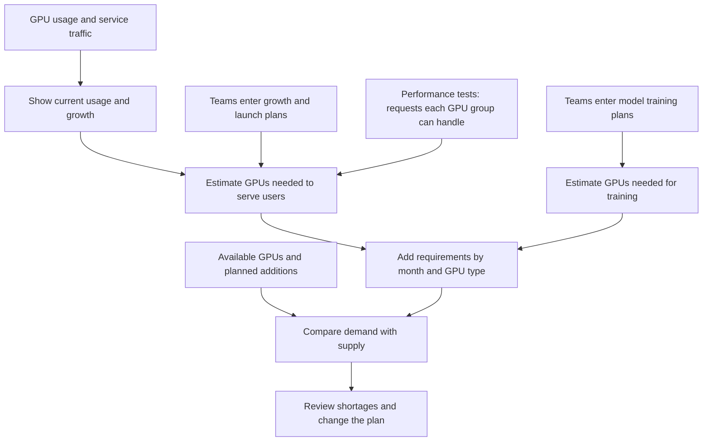

# GPU Atlas: GPU capacity planning

## What is the goal?

Help infrastructure teams answer one question:

**How many GPUs will the company need over the next six months, and where will
we run short?**

The portal should help them understand:

- Which services and teams use GPUs today.
- How usage and customer traffic are growing.
- What new models teams plan to train.
- Whether available GPUs can cover those needs.

Teams enter their plans and assumptions. Planners see the combined GPU requirement,
identify shortages, and compare changes before committing to a plan.

The portal runs in your browser and includes a sample 200,000-GPU inventory
and service history.

[Data inputs](#where-would-the-data-come-from) |
[Planning logic](#how-the-planning-logic-works) |
[Using the portal](#what-does-the-user-do) |
[Screenshots](#screenshots) |
[Run locally](#run-the-portal) |
[Limitations](#what-it-does-not-do-yet)

## How would it work?

First, collect current usage and inventory. Then ask teams what will change.
Use both to estimate future demand and compare it with supply.



In the current prototype, users enter or import the inputs themselves.
The connections described next are suggestions for a real deployment.

## Where would the data come from?

A **data pipeline** collects records from another system, checks them, and puts
them into a format the portal can use. A production version could use five:

### 1. GPU usage

Collect GPU activity from NVIDIA DCGM or Prometheus, and GPU assignment records
from Kubernetes or Slurm.

This tells us **which service was assigned GPUs, for how long, and how busy they
were**. Keep assigned capacity separate from actual activity: a team can hold
GPUs without keeping them busy.

### 2. Service traffic

Collect request counts, peak requests per second, response times, and request
sizes from API gateways or model-serving systems.

This tells us **how much work users are asking the service to do**. GPU usage
alone can miss demand that was queued or rejected.

### 3. Performance test results

Import tests showing how many requests a particular model and GPU configuration
can handle while meeting the required response time.

This tells us **how to convert expected traffic into GPUs**. Record the model,
GPU type, software setup, and input/output sizes alongside each result.

### 4. Hardware inventory

Read infrastructure records for installed GPUs, unavailable hardware, reserved
capacity, and new GPUs expected to become ready.

This tells us **how much capacity we can actually plan against**. A production
version should also track data-center locations, maintenance, and retirements.

### 5. Service ownership

Read the service catalog and team directory to connect jobs and usage records
to the right team.

This tells us **who is responsible for the demand**. Keep ownership history so a
service moving between teams does not change old reports incorrectly.

Before combining these inputs, agree on service IDs, dates, units, and GPU types.
Reject duplicates and flag missing records. Start with daily summaries; add
updates every few minutes when the source systems support them.

**None of these automated connections is built yet.** The current portal accepts
manual inputs and workspace JSON imports. Daily and weekly views are available;
live updates and historical ownership tracking are not.

## What does the user do?

The data tells us what happened. Teams still need to tell us what they intend
to do next.

1. **Review consumption.** Filter by service, team, or GPU type. Look at daily
   or weekly usage and check whether there is enough history to compare growth.
2. **Plan serving demand.** In **Inference growth**, enter expected traffic
   growth and launches. For a new service, enter expected users and usage instead.
3. **Choose serving performance.** Enter how many requests a group of GPUs can
   handle, or select a suitable test result from **Performance profiles**.
4. **Submit training plans.** In **Training roadmap**, enter model size, training
   data size, timing, hardware assumptions, and the number of simultaneous runs.
5. **Update supply.** In **Data & assumptions**, enter inventory, unavailable
   GPUs, reserves, and additions.
6. **Review the result.** In **Capacity requirements**, inspect monthly shortages
   by GPU type. Change inputs to compare alternatives, then export the plan.

For example, a planner could move a training plan from March to April or add
GPUs starting in February and see the effect. The portal recalculates the result;
it does not make those operational changes itself.

## How the planning logic works

### A. Measure current usage

Each daily service record contains assigned GPU-hours, average GPU activity,
peak requests per second, total requests, and whether the record is sample data
or user-entered.

**GPU-hours measure assigned capacity over time.** Eight GPUs assigned for three
hours equals 24 GPU-hours. That does not mean they were busy for all three hours.
The activity percentage is shown separately.

The portal adds these records into daily or weekly totals. Average assigned GPUs
uses the number of observed days; missing days are not filled with zero.
Activity averages are weighted by assigned GPU-hours.

Year-over-year and two-year comparisons need complete records for the matching
periods. If history is missing or the earlier value is zero, the portal says the
comparison is unavailable. These comparisons help users choose growth assumptions;
they do not automatically set the future growth rate.

### B. Estimate GPUs needed to serve requests

Using a trained model to answer requests is called **inference**.
The portal first estimates traffic, then converts that traffic into GPUs.

**Choose one way to estimate traffic:**

- **Use existing traffic.** Find the latest observation before planning starts,
  look back 28 calendar days, and use the highest recorded daily peak request rate.
  Apply the annual growth rate entered by the team, compounded monthly.
  Missing days and old observations remain visible; no missing traffic is invented.
- **Start from expected users.** Multiply daily users by sessions per user,
  requests per session, and model calls per request. Remove calls avoided entirely
  by cache. Divide by 86,400 to get average requests per second, then multiply by
  the team's peak-to-average traffic factor. In this mode, annual growth applies
  to users.

After either method, add the extra peak traffic entered for launches.
The monthly launch increment accumulates across the six months. Do not count
the same launch in both the growth rate and the launch input.

**Then convert peak traffic into GPUs:**

```text
GPU groups needed =
    round up(peak requests per second /
             (requests per second per group * usable share of serving capacity))

GPUs needed = GPU groups needed * GPUs per group
```

A group is one copy of the serving model, which may need several GPUs.
For 20% spare serving capacity, use 0.8 as the usable share.

**Example:** a service starts at 100,000 requests per second. The team expects
44% annual growth and adds 1,000 requests per second of launch traffic each month.
After six months, the estimated peak is 126,000 requests per second.

If an eight-GPU group handles 40 requests per second, with 20% capacity kept
spare, the service needs **3,938 groups, or 31,504 GPUs**.
These are illustrative inputs, not measured hardware performance.

A saved performance profile lets services share a test result. It must match
the GPU type, configuration key, and request-size limits, and its evidence must
be dated before planning starts. A mismatch makes the estimate unavailable;
the portal does not quietly use a different number. User-supplied test results
are not independently verified.

### C. Estimate GPUs needed for training

Teams enter model parameters, total training tokens, planned month, active days,
GPU speed and memory, expected training efficiency, and simultaneous runs.
Parameters and tokens are entered in billions.

The current calculator supports **dense-transformer pretraining**:

1. Estimate the work as roughly `6 * model parameters * training tokens`.
2. Divide that work by the available time and effective computing speed of one
   GPU to estimate the GPU count needed to finish.
3. Estimate a minimum GPU count for model weights, gradients, and optimizer memory.
4. Take the larger count and round up to the requested GPU group size.
5. Multiply by the number of runs happening at once.

Effective computing speed is the GPU's stated peak speed multiplied by expected
training efficiency. The UI calls that efficiency **MFU**: the share of peak
computing speed used for model work. It is not the GPU busy percentage.

The memory estimate excludes temporary working memory and communication buffers.
It is a minimum check, not proof that the job fits. The calculator also assumes
runs in the same month overlap; it does not find an efficient schedule.

### D. Compare demand with supply

For each month and GPU type:

```text
Total needed = serving GPUs + training GPUs

Available = installed - unavailable - reserve + additions ready by that month

Shortage = total needed - available
```

For example, `64,000 - 4,000 - 3,200 + 8,192` gives 64,992 available GPUs.
If demand is 70,000, the shortage is **5,008 GPUs**.

Keep GPU types separate: spare H100 GPUs do not automatically solve an H200
shortage. Likewise, a job needing 4,096 GPUs at once cannot run simply because
enough GPU-hours are available across different days.

New additions count from the start of their entered month. Service and team
filters reduce the displayed demand, but supply remains the shared company
inventory; the result is not a team's guaranteed allocation.

If a service cannot be estimated, the portal marks the total **partial** and
still shows the requirements it can calculate. A complete total means the inputs
exist, not that every assumption or physical placement has been verified.

### E. Check short-term traffic predictions

The **Forecast evidence** page asks a smaller question: *could a simple method
have predicted the next day's peak traffic?*

It compares:

- Yesterday's peak.
- The average of the same weekday over the previous four weeks.
- The average peak over the previous 28 days.

Each prediction uses only earlier observations. All three methods need the same
28 complete prior days and at least 14 days to test predictions on.
The earlier part of that test period chooses the method; the later part checks it
on days that were not used to choose it. Each part has at least seven days.

The page reports average error, percentage error, and whether predictions tend
to be too high or too low. You can export the scores and daily predictions.
This tests next-day traffic prediction, **not the accuracy of the six-month
capacity plan**. The six-month growth assumptions still come from users.

## Screenshots

These are captures of the original prototype using made-up data. The current
version also includes Performance profiles and Forecast evidence.

**Consumption:** see which services use GPUs and how usage changes.


**Inference planning:** edit growth and serving assumptions.


**Training:** enter model plans and inspect estimated GPU needs.


<details>
<summary>Show the training input form</summary>


</details>

**Capacity requirements:** compare demand with supply by month and GPU type.


<details>
<summary>Show inventory and workspace controls</summary>


</details>

## Run the portal

Open [portal/index.html](portal/index.html) in a browser. On Windows:

```powershell
Start-Process .\portal\index.html
```

There is no server, build step, or package installation.
Edits save in the browser's local storage. Export workspace JSON to keep a copy
or move it to another browser. Import replaces the workspace after validation
and confirmation. Older version-1 workspaces are upgraded without changing their
existing historical-demand calculations.

The sample history ends November 9, 2026. The default plan covers December 2026
through May 2027. You can enter a different planning start month.

Run the JavaScript calculation tests with Node.js:

```powershell
node --test .\tests\portal-model.test.cjs
```

The calculations are in [portal/model.js](portal/model.js), the UI is in
[portal/app.js](portal/app.js), and tests are in
[tests/portal-model.test.cjs](tests/portal-model.test.cjs).

## What it does not do yet

- **No live company data:** connections to monitoring, inventory, and service
  catalogs still need to be built. The sample inventory is not a fleet-scale
  performance test.
- **No shared company service:** there is no login, backend, or multi-user editing.
  Do not enter sensitive information in a shared browser.
- **No automatic allocation:** the portal does not grant quotas, borrow capacity,
  start jobs, purchase GPUs, or enforce a schedule.
- **No guarantee that a job can run:** it does not check network layout, connected
  GPU placement, complete memory fit, or detailed hardware compatibility.
- **No universal model calculator:** training support does not yet cover
  mixture-of-experts models, fine-tuning, or detailed long-context costs.
- **No guaranteed forecast:** plans depend on entered assumptions. Failures,
  changing efficiency, delayed deliveries, and correlated demand can change the
  outcome. There are no calibrated confidence ranges for the six-month plan.

Serving spare capacity is included in demand; the inventory reserve is deducted
from supply. Do not use both to cover the same risk.

## Separate experiment with public GPU job data

The repository also includes a Python experiment using Microsoft's public
**Philly trace**, a record of historical GPU jobs. It is separate from the
portal and does not provide the portal's sample data.

The experiment compares job scheduling with fixed team shares, borrowing unused
shares, prioritizing deadlines, and adding GPUs. It also tests simple forecasts
of daily job arrivals. Job-arrival counts are not themselves a GPU requirement.

The trace has no real planning deadlines or team quotas, so the experiment
creates those assumptions. Some job allocations do not match the static
inventory; the experiment reports that problem and uses a simplified shared
GPU budget instead of claiming exact hardware placement.

Risk estimates vary job runtimes, not every possible source of uncertainty.
Borrowing can delay another team, and adding GPUs cannot fix a deadline shorter
than a job's own runtime. Treat the results as experiments, not production
recommendations or proof that the approach works at hyperscale.

To run it on Windows, use Python 3.12+ and `curl.exe`. No Python packages are
required. The initial download is approximately **1 GB**:

```powershell
python download_trace.py
python prepare_trace.py
python -m unittest discover -s tests -v
python experiment.py
Start-Process .\results\index.html
```

The downloader verifies the archive's size and SHA-256. Preparation reads the job
log and machine inventory without expanding all the telemetry.
Generated files under `results` include an HTML report, JSON results, traffic
forecast CSVs, and per-job outcomes. Data and generated results are not committed.

## Data attribution

The experiment uses the [Microsoft Research / Project Fiddle Philly traces](https://github.com/msr-fiddle/philly-traces),
licensed under [CC BY 4.0](https://creativecommons.org/licenses/by/4.0/).
The source publication is *Analysis of Large-Scale Multi-Tenant GPU Clusters
for DNN Training Workloads*, USENIX ATC 2019.

Archive SHA-256:
`2037ccf63a725a02be718b0e1aeee6142c90b7f62d0d849295120e9f6ba13d2c`.

The experiment filters and summarizes the trace and adds hypothetical planning
rules. Preserve the source attribution and describe those changes when sharing
derived data.
